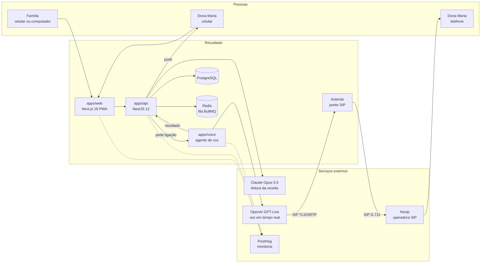
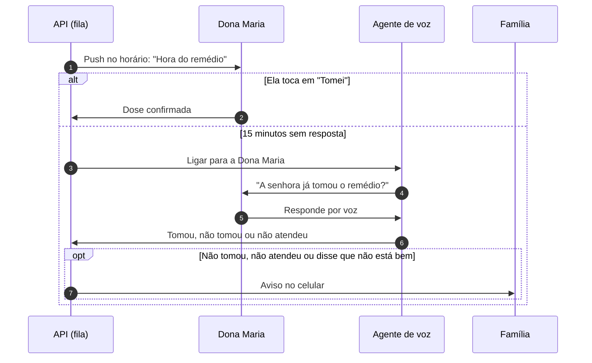

# Recuidado

[](https://github.com/lucianoiw/recuidado/actions/workflows/ci.yml)
[](LICENSE)

Agente de IA que cuida do remédio do idoso junto com a família.

O Recuidado lê a receita, mostra o que é de graça no Farmácia Popular, cota o resto com o teto da CMED e garante que a dose seja tomada. A Dona Maria recebe uma notificação no celular com um botão "Tomei". Se ela não confirmar, a IA liga para ela. Se mesmo assim não houver confirmação, a família é avisada.

Projeto do Hack Brasil 2026, trilha Saúde e bem-estar. Toda a demonstração usa dados fictícios. O Recuidado não faz diagnóstico, não recomenda tratamento e não altera dose.

- Demo: https://recuidado.com.br
- Contexto completo do projeto: [docs/context.md](docs/context.md)
- Painel de monitoria ao vivo (público, sem login): https://us.posthog.com/shared/agEAVqAn6xCM9GgdRycesljavVRvLg
- Como a monitoria funciona: [docs/monitoring.md](docs/monitoring.md)

## O que já funciona em produção

- **Receita lida por IA.** A família fotografa a receita e o Claude devolve cada remédio, dose e horário. A família revisa antes de salvar.
- **Lembrete no celular.** Notificação push no horário, com o botão "Tomei" na tela da Dona Maria.
- **Ligação de voz de verdade.** Sem confirmação, a IA liga para o telefone dela pela rede telefônica comum, pergunta se tomou e como ela está. Não precisa de app nem de internet do lado dela.
- **Família avisada.** Sem confirmação, ou se ela disser que não está bem, os filhos recebem o aviso na hora.
- **O que é grátis e onde.** Cada remédio é cruzado com a lista do Farmácia Popular, com o REMUME das UBS de São Paulo e com o Alto Custo, e a família vê as farmácias credenciadas mais perto.
- **Monitoria completa.** Logs, erros, eventos, traces da IA e replay das telas em um só lugar (PostHog).

## Impacto

- **32,1 milhões de brasileiros têm 60 anos ou mais**, 15,8% da população ([Censo 2022, IBGE](https://agenciagov.ebc.com.br/noticias/202310/brasileiros-com-60-anos-ou-mais-superam-32-milhoes-de-pessoas-mdhc-reforca-importancia-do-cuidado-e-respeito-com-essa-faixa-etaria)).
- **93% dos idosos usam ao menos um remédio de uso contínuo e 18% usam cinco ou mais** ([PNAUM, Ramos et al., Rev Saúde Pública 2016](https://revistas.usp.br/rsp/en/article/view/126591)).
- **30,8% dos adultos com doença crônica no Brasil têm baixa adesão ao tratamento** ([PNAUM, Tavares et al., Rev Saúde Pública 2016](https://scielosp.org/article/rsp/2016.v50suppl2/10s)). Lembrar de tomar é uma das barreiras medidas.
- **Só 50% dos pacientes crônicos seguem o tratamento nos países desenvolvidos**, e menos nos países em desenvolvimento ([OMS, 2003](https://www.who.int/news/item/01-07-2003-failure-to-take-prescribed-medicine-for-chronic-diseases-is-a-massive-world-wide-problem)).
- **Mediana de 4,29% das internações hospitalares está associada a não adesão a remédios** (revisão de 24 estudos, [BMJ Quality & Safety 2018](https://qualitysafety.bmj.com/content/27/11/902.abstract)).
- **40% das pessoas que moram sozinhas no Brasil têm 60 anos ou mais** ([PNAD Contínua 2025, IBGE](https://istoedinheiro.com.br/cresce-numero-de-brasileiros-que-vivem-sozinhos-revela-ibge)).
- **O Farmácia Popular atendeu mais de 24 milhões de pessoas em 2024 e hoje entrega os 41 itens do catálogo de graça** ([Agência Gov, 2025](https://agenciagov.ebc.com.br/noticias/202502/farmacia-popular-beneficiou-mais-de-24-milhoes-de-brasileiros-em-2024-maior-numero-da-serie-historica)).

Todos os números, o contexto de cada um e os que deixamos de fora por falta de fonte confiável estão em [docs/impact.md](docs/impact.md).

## Arquitetura



| Parte | O que faz | Tecnologia |
| --- | --- | --- |
| `apps/web` | App instalável (PWA). A família cadastra a Dona Maria, lê a receita e acompanha as doses. A Dona Maria vê o remédio da hora e confirma com um toque. | Next.js 16, React 19, Tailwind 4, Web Push |
| `apps/api` | Família, remédios, doses, leitura de receita e escalonamento. Agenda lembrete, ligação e aviso em uma fila. | NestJS 12, PostgreSQL, Drizzle, Redis, BullMQ |
| `apps/voice` | Liga para a Dona Maria, conversa por voz e devolve o resultado para a API. | OpenAI GPT-Live por SIP, Asterisk, Nvoip |
| `packages/prescription-reader` | Leitura de receita (inclusive manuscrita) com saída estruturada. | Claude Opus 5.5 |
| `packages/data` | Coleta e cruzamento de dados públicos de remédios e farmácias. | Scripts Node, Firecrawl |
| `packages/telemetry` | Eventos, erros, traces de IA e exportação de logs para o PostHog. | posthog-node, OTLP |

## Fluxo de uma dose



Os tempos são configuráveis (`DOSE_CALL_AFTER_MINUTES` e `DOSE_ALERT_AFTER_MINUTES`). Doses no mesmo horário são confirmadas juntas.

Modo demo: na tela Hoje da família, "Demo em 2 minutos" (`/family/demo`) cria uma dose extra de agora e roda esse mesmo fluxo com esperas em segundos (`DEMO_CALL_AFTER_SECONDS` e `DEMO_ALERT_AFTER_SECONDS`): lembrete, ligação de verdade e aviso para a família. A tela mostra cada passo e o que foi dito na ligação. A agenda normal não muda, e os eventos dessa dose vão para o PostHog com `demo: true`. `DEMO_RUN_ENABLED=false` desliga o botão.

## Resultados medidos

| O quê | Resultado | Como medir de novo |
| --- | --- | --- |
| Leitura de receita (3 receitas sintéticas, uma manuscrita) | 3 de 3 corretas, de 12 a 16 s cada, cerca de US$ 0,06 por receita | `pnpm prescription:eval` |
| Ligação de voz | Ligação real ponta a ponta para um celular, com confirmação da dose por voz | `POST /demo/missed-dose` na API |
| Qualidade do código | Lint, testes e build em todos os pacotes a cada push | [CI](https://github.com/lucianoiw/recuidado/actions/workflows/ci.yml) |

## Monitoria

Tudo vai para o PostHog: logs de todos os serviços (que sobrevivem a deploy e restart), erros com stack trace, uma linha por requisição HTTP, eventos de produto (lembrete, dose confirmada, ligação, família avisada), cada chamada de IA com modelo, latência, tokens e custo, e o replay das telas com os campos mascarados.

O painel mostra adesão às doses, o funil do lembrete até o "Tomei", ligações por resultado, latência da IA e erros por serviço. Um alerta por e-mail dispara quando aparece um erro novo ou quando uma ligação falha. A transcrição da ligação não vai para o PostHog: ela fica só no Postgres.

[Abrir o painel ao vivo](https://us.posthog.com/shared/agEAVqAn6xCM9GgdRycesljavVRvLg) (público, sem login). Detalhes em [docs/monitoring.md](docs/monitoring.md).

## Dados públicos

| Fonte | Uso |
| --- | --- |
| Farmácia Popular (Ministério da Saúde) | Remédios gratuitos e farmácias credenciadas |
| CMED (Anvisa) | Preço máximo ao consumidor, usado como teto |
| CNES (DataSUS) | Farmácias e UBS perto da Dona Maria |
| REMUME (Prefeitura de São Paulo) | Remédios entregues nas UBS |
| CEAF (Secretaria da Saúde de SP) | Remédios do Alto Custo |

A região da demo é São Paulo capital. Detalhes em [packages/data/README.md](packages/data/README.md).

## Segurança e privacidade

- Toda a demo usa dados sintéticos. A Dona Maria é uma personagem.
- Segredos só em variáveis de ambiente, nunca no repositório ([.env.example](.env.example) lista os nomes).
- O replay das telas mascara todos os campos digitados.
- O agente não faz diagnóstico, não recomenda tratamento e não muda dose. A família revisa a leitura da receita antes de salvar.

## Rodar localmente

Requisitos: Node 22+, pnpm 10 e Docker.

```bash
cp .env.example .env
pnpm install
pnpm db:up        # Postgres e Redis locais em Docker
pnpm dev          # web em http://localhost:3000, api em http://localhost:4000
```

Testes, lint e build:

```bash
pnpm lint && pnpm test && pnpm build
```

## Deploy

No Coolify, com um recurso para cada parte (web, api, voz, Asterisk, Postgres e Redis). Cada push na `main` faz o deploy automático. Os detalhes estão em [deploy/README.md](deploy/README.md).

## Licença

[MIT](LICENSE)
