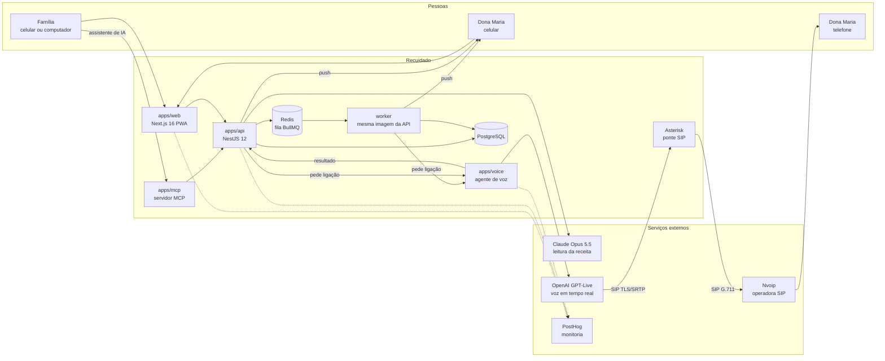
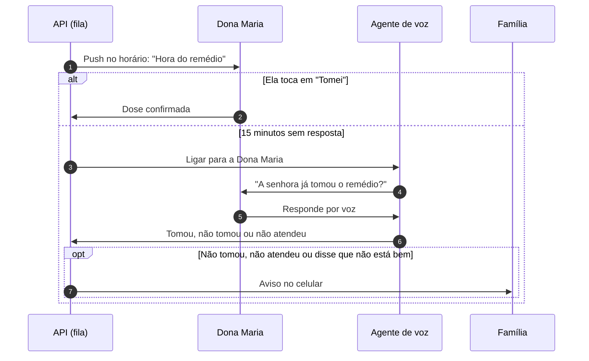

# Recuidado

[](https://github.com/lucianoiw/recuidado/actions/workflows/ci.yml)
[](LICENSE)

Agente de IA que cuida do remédio do idoso junto com a família.

O Recuidado lê a receita, mostra o que é de graça no Farmácia Popular, cota o resto com o teto da CMED e garante que a dose seja tomada. A Dona Maria recebe uma notificação no celular com um botão "Tomei". Se ela não confirmar, a IA liga para ela. Se mesmo assim não houver confirmação, a família é avisada.

Projeto do Hack Brasil 2026, trilha Saúde e bem-estar. Toda a demonstração usa dados fictícios. O Recuidado não faz diagnóstico, não recomenda tratamento e não altera dose.

- Demo: https://recuidado.com.br
- Contexto completo do projeto: [docs/context.md](docs/context.md)
- Painel de monitoria ao vivo (público, sem login): https://us.posthog.com/shared/agEAVqAn6xCM9GgdRycesljavVRvLg
- Como a monitoria funciona: [docs/monitoring.md](docs/monitoring.md)

## O que já funciona em produção

- **Receita lida por IA.** A família fotografa a receita e o Claude devolve cada remédio, dose e horário. A família revisa antes de salvar.
- **Lembrete no celular.** Notificação push no horário, com o botão "Tomei" na tela da Dona Maria.
- **Ligação de voz de verdade.** Sem confirmação, a IA liga para o telefone dela pela rede telefônica comum, pergunta como ela está e se tomou. Não precisa de app nem de internet do lado dela. Se ela disser que caiu ou está com dor no peito, a IA liga para o filho na mesma hora. Ver [Ligação para a Dona Maria](#ligação-para-a-dona-maria).
- **Família avisada.** Sem confirmação, ou se ela disser que não está bem, os filhos recebem o aviso na hora, por push e por e-mail. Todo aviso também fica na tela Avisos do app, com o sino de novos na tela Hoje. Ver [Avisos da família](#avisos-da-família).
- **A IA liga para a farmácia.** Em "Onde comprar", a família toca em "Perguntar à farmácia". A IA liga, se apresenta como assistente virtual, passa pelo menu de teclas (URA) sozinha, pergunta se tem, quanto custa a caixa e se sai pelo Farmácia Popular, e a resposta aparece comparada ao teto da CMED. Ver [Ligação para a farmácia](#ligação-para-a-farmácia).
- **O que é grátis e onde.** Cada remédio é cruzado com a lista do Farmácia Popular, com o REMUME das UBS de São Paulo e com o Alto Custo, e a família vê as farmácias credenciadas mais perto.
- **MCP para qualquer assistente de IA.** Claude, ChatGPT ou outro agente consulta o plano, as doses e os avisos da família por conversa. Ver [Servidor MCP](#servidor-mcp).
- **Monitoria completa.** Logs, erros, eventos, traces da IA e replay das telas em um só lugar (PostHog).

## Impacto

- **32,1 milhões de brasileiros têm 60 anos ou mais**, 15,8% da população ([Censo 2022, IBGE](https://agenciagov.ebc.com.br/noticias/202310/brasileiros-com-60-anos-ou-mais-superam-32-milhoes-de-pessoas-mdhc-reforca-importancia-do-cuidado-e-respeito-com-essa-faixa-etaria)).
- **93% dos idosos usam ao menos um remédio de uso contínuo e 18% usam cinco ou mais** ([PNAUM, Ramos et al., Rev Saúde Pública 2016](https://revistas.usp.br/rsp/en/article/view/126591)).
- **30,8% dos adultos com doença crônica no Brasil têm baixa adesão ao tratamento** ([PNAUM, Tavares et al., Rev Saúde Pública 2016](https://scielosp.org/article/rsp/2016.v50suppl2/10s)). Lembrar de tomar é uma das barreiras medidas.
- **Só 50% dos pacientes crônicos seguem o tratamento nos países desenvolvidos**, e menos nos países em desenvolvimento ([OMS, 2003](https://www.who.int/news/item/01-07-2003-failure-to-take-prescribed-medicine-for-chronic-diseases-is-a-massive-world-wide-problem)).
- **Mediana de 4,29% das internações hospitalares está associada a não adesão a remédios** (revisão de 24 estudos, [BMJ Quality & Safety 2018](https://qualitysafety.bmj.com/content/27/11/902.abstract)).
- **40% das pessoas que moram sozinhas no Brasil têm 60 anos ou mais** ([PNAD Contínua 2025, IBGE](https://istoedinheiro.com.br/cresce-numero-de-brasileiros-que-vivem-sozinhos-revela-ibge)).
- **O Farmácia Popular atendeu mais de 24 milhões de pessoas em 2024 e hoje entrega os 41 itens do catálogo de graça** ([Agência Gov, 2025](https://agenciagov.ebc.com.br/noticias/202502/farmacia-popular-beneficiou-mais-de-24-milhoes-de-brasileiros-em-2024-maior-numero-da-serie-historica)).

Todos os números, o contexto de cada um e os que deixamos de fora por falta de fonte confiável estão em [docs/impact.md](docs/impact.md).

## Arquitetura



| Parte | O que faz | Tecnologia |
| --- | --- | --- |
| `apps/web` | App instalável (PWA). A família cadastra a Dona Maria, lê a receita e acompanha as doses. A Dona Maria vê o remédio da hora e confirma com um toque. | Next.js 16, React 19, Tailwind 4, Web Push |
| `apps/api` | Família, remédios, doses, leitura de receita e escalonamento. Agenda lembrete, ligação e aviso em uma fila. | NestJS 12, PostgreSQL, Drizzle, Redis, BullMQ, Resend |
| worker (`apps/api/src/worker`) | Executa a fila na hora certa: lembrete, ligação, segunda ligação, aviso à família, ligação de volta, e agenda as doses de hora em hora. Processo próprio, sem servidor HTTP e sem controllers: carrega só o banco, a fila e os serviços que os jobs usam. A API não consome a fila. Separado para um não derrubar o outro, o deploy da API não parar a fila e cada um escalar sozinho. Usa os mesmos serviços da API (uma implementação de cada passo), e os dois sobem a cada push na main. Os jobs ficam no Redis e sobrevivem a reinício. | NestJS 12 (application context), BullMQ |
| `apps/voice` | Liga para a Dona Maria, conversa por voz e devolve o resultado para a API. | OpenAI GPT-Live por SIP, Asterisk, Nvoip |
| `apps/mcp` | Servidor MCP sobre a API: qualquer assistente de IA consulta o plano, as doses, os avisos e onde o remédio é grátis. | MCP TypeScript SDK v2, Streamable HTTP |
| `packages/prescription-reader` | Leitura de receita (inclusive manuscrita) com saída estruturada. | Claude Opus 5.5 |
| `packages/data` | Coleta e cruzamento de dados públicos de remédios e farmácias. | Scripts Node, Firecrawl |
| `packages/telemetry` | Eventos, erros, traces de IA e exportação de logs para o PostHog. | posthog-node, OTLP |

## Servidor MCP

Endereço: `https://mcp.recuidado.com.br` (Streamable HTTP). Ao conectar, abre a tela "Conexão da família": um toque em Autorizar liga o assistente à família de demonstração, sem senha. Quem cadastrou a própria família cola o link do convite. Por baixo é OAuth 2.1 com PKCE, então o assistente só enxerga a família que foi conectada.

| Ferramenta | O que faz |
| --- | --- |
| `get_care_plan` | Remédios, horários, onde cada um é grátis (Farmácia Popular, UBS), Alto Custo, custo do mês e comprimidos restantes |
| `get_today_doses` | Doses de hoje: tomada, pendente ou perdida, como foi confirmada e se a família foi avisada |
| `confirm_dose` | Marca uma dose de hoje como tomada, igual ao botão "Tomei" |
| `list_family_alerts` | Avisos enviados à família: dose não confirmada, não está bem, remédio acabando |
| `find_free_medicine` | Busca um remédio e diz, por dosagem, onde é grátis e se entra no Alto Custo |

O telefone nunca sai nas respostas, e o servidor não dá conselho clínico. Detalhes em [apps/mcp/README.md](apps/mcp/README.md).

**Decisões e achados.**
- Serviço separado sobre a API pública, e não dentro da API: o MCP vê exatamente o que o app vê, e não conflita com o resto.
- SDK MCP v2 (especificação de 28/07/2026), sem estado. Clientes antigos (especificação de 2025) também funcionam; testado com os dois.
- Login de propósito simples, porque é prova de conceito com dados fictícios. Os tokens são assinados, nada fica guardado, e um redeploy não desconecta ninguém.
- Siri: pesquisado em 11/11/2026, não achamos fonte confiável de que a Siri do iOS 27 aceite servidor MCP pela URL. O caminho da Apple é App Intents, que exige app instalado. O mais perto hoje é usar o app do Claude ou do ChatGPT por voz com este conector.

**Como conectar.** No Claude: Configurações, Conectores, Adicionar conector personalizado, URL acima, e tocar em Autorizar. No Claude Code: `claude mcp add --transport http recuidado https://mcp.recuidado.com.br`.

**Casos de uso**

1. **Pergunta rápida no celular.** O filho pergunta ao Claude ou ao ChatGPT, por texto ou voz, até dirigindo: "a mãe tomou o remédio da pressão hoje?".
2. **Resumo automático.** Uma tarefa agendada no assistente, todo dia às 21h: "como foram as doses da mãe hoje e teve algum aviso?". O resumo chega sem abrir o app.
3. **Na consulta médica.** "Liste os remédios e horários da minha mãe." O assistente monta a lista para mostrar ao médico.
4. **Receita nova ou balcão da farmácia.** "Atorvastatina 20 mg é grátis?" A resposta diz se é grátis no Farmácia Popular, na UBS ou se entra no Alto Custo.
5. **Ela ligou e disse que tomou.** "Marca que ela tomou o das 8." A dose é confirmada e a ligação e o aviso daquela dose são cancelados.
6. **Agenda.** "Coloque os horários de remédio da mãe no meu Google Agenda." O assistente lê o Recuidado e grava na agenda do filho.
7. **Lista de compras.** "O que está acabando?" O que estiver acabando vai para a lista no Notion, no Todoist ou nas notas.
8. **Grupo da família.** O assistente escreve o resumo da semana para os irmãos, e o filho só envia.

Os casos 6 a 8 usam o conector do Recuidado junto com outro conector do mesmo assistente (agenda, notas). O Recuidado não acessa esses serviços.

## Fluxo de uma dose



Os tempos são configuráveis (`DOSE_CALL_AFTER_MINUTES` e `DOSE_ALERT_AFTER_MINUTES`). Doses no mesmo horário são confirmadas juntas.

Modo demo: na tela Hoje da família, "Demo em 2 minutos" (`/family/demo`) cria uma dose extra de agora e roda esse mesmo fluxo com esperas em segundos (`DEMO_CALL_AFTER_SECONDS` e `DEMO_ALERT_AFTER_SECONDS`): lembrete, ligação de verdade e aviso para a família. A tela mostra cada passo e o que foi dito na ligação. A agenda normal não muda, e os eventos dessa dose vão para o PostHog com `demo: true`. `DEMO_RUN_ENABLED=false` desliga o botão.

## Avisos da família

Toda mensagem para os cuidadores sai por push e por e-mail ao mesmo tempo e também fica salva (`alerts`) e aparece em `/family/avisos`, do mais novo para o mais antigo, agrupada por dia. Na tela Hoje, o sino mostra quantos avisos chegaram desde a última vez que a pessoa abriu a tela (contado no aparelho).

| Tipo | Quando |
| --- | --- |
| Dose não confirmada | Ninguém tocou em "Tomei" e a ligação não confirmou |
| Disse que não está bem | Na ligação, qualquer queixa, com as palavras dela |
| Emergência | Queda, dor no peito, falta de ar ou desmaio na ligação (push urgente) |
| Ligação para a família | A ligação de voz para o primeiro contato, com o recado dito (sem push) |
| Ligação de volta | Resultado da ligação para ela depois da emergência |
| Remédio acabando | Estoque para `LOW_STOCK_DAYS` dias ou menos |

Cada aviso diz por onde chegou ("Notificação em 2 celulares e e-mail para 2 pessoas", "Por ligação de voz", ou "Só no app" quando ninguém ligou a notificação nem deu e-mail).

**E-mail com Resend (tecnologia de patrocinador do Hack Brasil).** O cuidador informa o e-mail no cadastro (opcional). Todo aviso que vai por push também vai por e-mail, enviado pelo Resend a partir de `avisos@recuidado.com.br` (domínio verificado com SPF e DKIM no Cloudflare). Cada pessoa recebe o próprio e-mail, sem ver os outros endereços, com o mesmo título e texto do push e um botão que abre a tela de avisos. Por que e-mail além do push: o push não chega no iPhone sem o app na Tela de Início, nem em quem negou a permissão, e some quando a pessoa limpa as notificações. O e-mail chega em qualquer celular ou computador e fica na caixa de entrada. Uma falha do Resend nunca impede o push nem o registro do aviso. A Família Demo é sintética e não tem e-mail: os avisos dela vão para `DEMO_ALERT_EMAILS`, um endereço da equipe configurado só no servidor. Envio e falhas vão para o PostHog (`alert_email_sent`, `alert_email_failed`).

**Por que uma tela e não só o push (decidido em 11/11).** O push some quando a pessoa toca nele ou limpa as notificações, chega só em quem permitiu e não chega em aba anônima nem no iPhone sem o app na Tela de Início. A tela deixa qualquer filho ver depois o que aconteceu, inclusive quem entrou na família depois. Ela também mostra que o aviso é independente do canal: o mesmo título e texto salvos em `alerts` podem sair por WhatsApp no futuro (por exemplo, com mensagem de modelo aprovada na API oficial), sem mudar o fluxo. Para o hackathon os canais são o push e o e-mail, pelo mesmo motivo da ligação: WhatsApp exige conta oficial verificada e aprovação de modelos que não cabem no prazo.

## Ligação para a Dona Maria

Uma conversa curta e calorosa, feita para uma pessoa idosa ao telefone.

- **Roteiro (revisado frase por frase pelo Luciano em 11/11).** "Oi, Dona Maria, bom dia! Aqui é a assistente virtual da Recuidado. Como a senhora está?". Ela responde, a IA reage curto ("Que bom!", e "Estou bem também, obrigada" só se ela perguntar) e pergunta "A senhora já tomou a Losartana das duas da tarde?". O horário é dito por extenso ("das duas da tarde"), porque "às 14:00" soa como se perguntasse se tomou exatamente naquela hora. Com 3 ou mais remédios no horário, pergunta pelos "remédios das duas da tarde" em vez de ler a lista. Para ela a IA diz "remédio", nunca "medicamento". Se tomou: "Obrigada, tchau, Dona Maria!".
- **Senhor ou senhora.** O cadastro tem "Na ligação, a assistente fala: A senhora / O senhor" (`members.gender`, padrão senhora). Muda o tratamento nas falas para ele e o "ele/ela" na fala para o filho.
- **Ainda não tomou.** A IA pede "A senhora pode tomar agora, por favor?". Se ela confirma na hora, conta como tomado. Se não, "Tá bom, Dona Maria, daqui a pouco eu ligo para confirmar. Obrigada, tchau, Dona Maria!", e a Recuidado liga de novo depois de `DOSE_RECALL_MINUTES` (15 min): "Oi, Dona Maria! É a assistente virtual da Recuidado de novo. A senhora já tomou a Losartana das duas da tarde?". Só se na segunda ligação ela ainda não tomou ("Tá bom, Dona Maria. Não esqueça de tomar, viu? Obrigada, tchau, Dona Maria!") a família é avisada. Avaliamos ficar na linha esperando ela tomar e descartamos: custa minuto, deixa silêncio na ligação e o modelo tende a desligar ou falar sem necessidade. A ligação do modo demo (2 min) não tem segunda ligação, para o vídeo caber no tempo.
- **Sem silêncio no começo.** O GPT-Live leva cerca de 3,6 s para começar a falar depois que a pessoa atende (medido). Na primeira ligação, o serviço de voz grava a saudação na própria voz da IA. Nas seguintes, toca essa gravação no instante em que ela atende, e a IA continua a conversa ao vivo. É uma gravação por nome, período (bom dia, boa tarde, boa noite) e voz.
- **Sem conta de telefone à toa.** A IA diz o tchau junto com o registro da resposta. Depois espera até 3 s pela despedida dela e desliga 1 s após ela parar de falar, porque muitos idosos não desligam.
- **Como ela está.** Qualquer queixa, até cansaço ou tontura, vira um aviso por push para a família, com as palavras dela. A IA não dá conselho de saúde: só diz "Poxa. Vou avisar a sua família." e segue para o remédio. Cansaço sozinho não é emergência: idoso diz "tô cansada" com frequência, e ligar para o filho a cada vez seria alarme falso.
- **Emergência.** Queda, dor no peito, falta de ar, desmaio ou fraqueza a ponto de não levantar: a IA não pergunta do remédio e diz só, com calma e sem "ai, meu Deus": "Entendi, Dona Maria, eu vou ligar e avisar a sua família e já te ligo de volta para saber como a senhora está, tá bom? Até já.". Desliga na hora, para a linha dela ficar livre para o filho ligar.
  - A família recebe um push urgente. O primeiro contato (só ele, para não causar alarde) recebe uma ligação com as palavras dela, tiradas da transcrição: "Olá, aqui é a assistente virtual da Recuidado. Liguei para Dona Maria para saber sobre o medicamento, e ela disse: "Eu caí no banheiro". Por favor, entre em contato com ela agora. Se for grave, ligue para o SAMU, 192." O serviço de voz considera o recado entregue quando ouve o SAMU e desliga 2,5 s depois.
  - Depois de `EMERGENCY_CHECKIN_MINUTES` (10 min, tempo para o filho ligar antes) a Recuidado liga de volta: "Oi, Dona Maria! É a assistente virtual da Recuidado de novo. Já avisei a sua família. Como a senhora está se sentindo agora?".
  - Se ela está melhor ou alguém da família já está com ela ("meu filho já veio"): "Que bom. Vou avisar a sua família. Espero que fique bem. Tchau, Dona Maria!". A família recebe um push com o que ela disse, e acabou.
  - Se ela ainda não está bem: "Tá bom, Dona Maria, vou avisar a sua família de novo. Já te ligo de novo. Até já!". O primeiro contato recebe outra ligação ("Liguei de novo para Dona Maria e ela disse: ...") e a Recuidado liga de novo para ela, até 3 vezes. Se ela não atende: "Liguei de novo para Dona Maria e ela não atendeu. Por favor, entre em contato com ela agora. Se for grave, ligue para o SAMU, 192." O SAMU fica também aqui de propósito: não atender depois de uma queda é o caso mais grave.
  - Garantia no código: o modelo nem sempre segue o prompt (em teste ele respondeu uma queda com "Já volto. Tchau"). Se a resposta registrada é emergência e ela não ouviu "vou avisar a sua família", o serviço de voz manda a frase exata e só desliga depois do tchau ou do "até já".
- **Primeiro contato.** A família escolhe, na aba Família, quem recebe a ligação de emergência (`members.emergency_contact`, `PUT /family/members/:id/emergency-contact`). Ligar para todos os filhos ao mesmo tempo causaria alarde e várias pessoas ligando para a mesma linha; os outros recebem só o push. Sem escolha, é quem fez o cadastro (o cuidador mais antigo com celular). Na família demo, o Carlos é o primeiro contato, e a API volta a marcá-lo a cada reinício.
- **Caixa postal e triagem.** Mensagem de caixa postal encerra a ligação como "não atendeu". Para o assistente de triagem do celular, a IA se apresenta como "Recuidado, lembrete do remédio".
- **Por baixo.** GPT-Live (voz `bossa`, português do Brasil) disca por SIP com TLS e SRTP para um Asterisk na VPS, que converte o áudio e repassa para a Nvoip. Um modelo delegado com raciocínio baixo grava a resposta em cerca de 1 s. Cada ligação fica no Postgres (`voice_calls`) com transcrição, resultado e motivo do fim.

- **Por que telefone e não ligação pelo WhatsApp (decidido em 11/11).** Avaliamos a ligação iniciada pela empresa da API de ligações do WhatsApp (Cloud API Calling). Ela existe no Brasil, custa cerca de US$ 0,011 por minuto e aceita SIP com TLS, SRTP (SDES) e G.711 ou Opus, então o nosso Asterisk conseguiria ligar o GPT-Live a ela. Ficou fora por três motivos: (1) a Meta exige limite de mensagens de pelo menos 2.000 destinatários por dia no número da empresa, o que pede conta oficial e verificação que não cabem no prazo; o número de teste da Meta dispensa esse limite, mas é dos EUA, onde a ligação iniciada pela empresa não é permitida, e não confirmamos se o teste abre exceção; (2) a Dona Maria precisaria aceitar antes um pedido de permissão no WhatsApp, e 4 ligações seguidas sem atender revogam essa permissão, o que é comum com idoso; (3) o telefone comum chega a qualquer pessoa, sem app nem internet. A falha vista nos testes de emergência era de uma linha específica, não da arquitetura. A ligação pelo WhatsApp fica no roadmap como canal extra para quem já usa WhatsApp.

## Ligação para a farmácia

O agente não só lembra: ele executa no mundo real. Liga para a farmácia, pergunta e traz a resposta como dado.

- **Roteiro.** Espera o outro lado falar. A primeira frase para uma pessoa é sempre "Aqui é a assistente virtual da Recuidado, ligando em nome de uma família". Pergunta, para até 3 remédios, estoque, preço da caixa e Farmácia Popular. Nunca compra, reserva ou passa dado pessoal.
- **Menu de teclas (URA).** O GPT-Live envia DTMF pelo SIP (evento `transport.dtmf.send` no sideband): uma tecla por evento, e o Asterisk repassa para a Nvoip (RFC 4733). Quem escolhe a tecla é o nosso código: ele lê a transcrição do menu e, quando o menu faz uma pausa, aperta a opção de preço e estoque (ou atendente, ou remédios). A ferramenta `press_phone_keys` do modelo fica como reserva para menus que a regra não entende.
- **Resposta gravada em duas camadas.** O modelo deve dizer o tchau e, ao mesmo tempo, chamar `record_pharmacy_answer`. Se a ligação termina sem esse registro, o Claude (Sonnet 5.5) lê a transcrição e preenche estoque, preço da caixa e Farmácia Popular, sem calcular nem chutar preço. Enquanto ele lê (cerca de 4 s), o card continua em "ligando".
- **Comparação com a CMED.** O preço dito por telefone é comparado ao teto da CMED por comprimido ("Dentro do teto" ou "Acima do teto"). A tela diz que preço por telefone é referência, não oferta.
- **Sem ligar para terceiros.** Só disca `PHARMACY_CALL_PHONE`, que precisa estar listado um a um na whitelist (`*` não vale para farmácia). O Asterisk atende `+5500000000000` (DDD 00 não existe) com uma URA de teste: menu com voz sintética e uma atendente gravada. Assim a demo mostra a ligação inteira, com teclas, sem incomodar uma farmácia de verdade. As ligações para farmácia contam nos mesmos limites diários.
- **Achados de 8 ligações reais à URA de teste (11/11).** O modelo de voz é instável com menus e ferramentas, então cada falha virou uma regra no nosso código:
  - Ela falou com o menu gravado e, quando a atendente falou primeiro, pulou a frase de assistente virtual. Agora o código detecta o menu e manda a apresentação quando uma pessoa fala e faz uma pausa.
  - Em uma ligação ela disse "Opção 2" em voz alta em vez de apertar a tecla, e o menu repetiu por 177 s. Em outra, apertou a tecla errada. Agora a tecla é escolhida por regra (palavras "preço", "estoque", "atendente").
  - Nas três últimas ligações ela se despediu sem chamar a ferramenta de registro, e a atendente desligou. A leitura da transcrição pelo Claude recuperou a resposta certa nas duas em que já existia.
  - Resultado final (8ª ligação): menu, tecla 2, apresentação, pergunta, resposta "tem, R$ 32,50, caixa com 30, sai pelo Farmácia Popular" e tchau, em 46 s.
- **Problema que sobrou.** O modelo ainda fala com o menu ("Um instante, vou escolher a opção") antes da tecla sair, e às vezes fala por cima da atendente.
- **Como outras empresas resolvem (pesquisa de 11/11).** Ninguém confia no modelo de conversa para lidar com o menu sozinho:
  - **Classificar fora da conversa.** O LiveKit roda a detecção (pessoa, URA, caixa postal) fora do agente, com um LLM lendo a transcrição: mediana de 840 ms, F1 de 98,2% para URA, e na dúvida trata como pessoa ([LiveKit](https://livekit.com/blog/answering-machine-detection)). O Pipecat tem um modo URA separado do modo conversa e troca o prompt quando detecta uma pessoa ([Pipecat](https://docs.pipecat.ai/pipecat/fundamentals/ivr)).
  - **Esperar o menu acabar.** Pausa antes de apertar: Retell 1 s por padrão (até 5 s) ([Retell](https://docs.retellai.com/build/single-multi-prompt/press-digit)); Pipecat espera 2 s de silêncio no modo URA e 0,8 s com pessoa; Vapi deixa o turno mais lento nos primeiros 30 s da ligação e manda o modelo responder com um espaço (silêncio) enquanto o menu fala ([Vapi](https://docs.vapi.ai/ivr-navigation)). Tecla apertada no meio do menu é ignorada por muitas URAs; o Retell diz que o tempo errado leva ao setor errado em cerca de um terço das URAs comuns ([Retell](https://www.retellai.com/blog/how-voice-ai-handles-hardest-parts-real-call)).
  - **Tecla como evento RFC 4733**, não como som, e intervalo de 3 s entre teclas do modelo (LiveKit, [receita](https://docs.livekit.io/reference/recipes/ivr-navigator)). Já fazemos as duas coisas.
  - **Silêncio na espera e memória do caminho.** A Sierra diz que o mais difícil é ficar quieto na espera e perceber quando a pessoa atende; ela guarda qual caminho funciona em cada empresa, e com isso subiu o acerto de 57% para 85% ([Sierra](https://sierra.ai/blog/navigating-ivr-systems)).
- **O que o GPT-Live permite (documentação da OpenAI).** Não tem evento para calar a saída do modelo, nem para cancelar a fala, nem ajuste de turno ([controles do servidor](https://developers.openai.com/api/docs/guides/voice-server-controls)). Ele é full duplex: fala e ouve ao mesmo tempo ([conversas](https://developers.openai.com/api/docs/guides/live-conversations)). O que existe: `session.instructions.append` pode interromper a fala em andamento; `session.output_audio.fixture.play` interrompe a fala, mas também descarta o que o outro lado diz enquanto toca; e os gatilhos de Decisions (`session.triggers`) fazem perguntas de escolha a cada trecho da transcrição ([sideband](https://developers.openai.com/api/reference/resources/live/sideband-websocket), [Decisions](https://developers.openai.com/ja-JP/api/docs/guides/decisions-voice)). Ou seja: com o GPT-Live, o jeito garantido de ele não falar com o menu é ele não ouvir o menu.
- **Recomendação para o Recuidado: passar pelo menu no Asterisk, antes de ligar o GPT-Live.** O `Dial` do Asterisk tem a opção `U()`, que roda uma rotina na perna da farmácia depois que ela atende e antes de conectar quem ligou ([Dial](https://docs.asterisk.org/Certified-Asterisk_20.7_Documentation/API_Documentation/Dialplan_Applications/Dial/)). A rotina espera o menu fazer uma pausa (`WaitForSilence`), aperta o caminho conhecido daquela farmácia (`SendDTMF`, ex.: `2`) e só então conecta. Enquanto isso, a ligação da OpenAI continua "chamando" (o limite é 3 min, [voice-sip](https://developers.openai.com/api/docs/guides/voice-sip)): o modelo não ouve o menu e não fala com ele. O caminho por farmácia fica em uma variável, como faz a Sierra. Para farmácia sem caminho conhecido, continua a regra atual no nosso código. A URA de teste passa a ser discada por `Local/`, para seguir o mesmo caminho. Ainda não testado: se a Nvoip manda áudio antes do atendimento e se a atendente fala durante a troca.
- **Para a atendente, mesmo depois do menu.** Mandar `session.instructions.append` ("é uma gravação, fique em silêncio") quando o nosso código detectar menu ou mensagem de espera, para cortar a fala. Detecção pela regra de palavras (hoje) e, se precisar, por um gatilho de Decisions com a pergunta "menu, espera, pessoa ou caixa postal".

## Resultados medidos

| O quê | Resultado | Como medir de novo |
| --- | --- | --- |
| Leitura de receita (3 receitas sintéticas, uma manuscrita) | 3 de 3 corretas, de 12 a 16 s cada, cerca de US$ 0,06 por receita | `pnpm prescription:eval` |
| Ligação de voz | Ligação real ponta a ponta para um celular, com confirmação da dose por voz | `POST /demo/missed-dose` na API |
| Ligação para a farmácia com URA | Ligação real ao menu de teste: tecla 2 por DTMF escolhida por regra, estoque, preço e Farmácia Popular gravados, 46 s (8ª ligação) | Botão "Perguntar à farmácia" em `/family/comprar` |
| Qualidade do código | Lint, testes e build em todos os pacotes a cada push | [CI](https://github.com/lucianoiw/recuidado/actions/workflows/ci.yml) |

## Monitoria

Tudo vai para o PostHog: logs de todos os serviços (que sobrevivem a deploy e restart), erros com stack trace, uma linha por requisição HTTP, eventos de produto (lembrete, dose confirmada, ligação, família avisada), cada chamada de IA com modelo, latência, tokens e custo, e o replay das telas com os campos mascarados.

O painel mostra adesão às doses, o funil do lembrete até o "Tomei", ligações por resultado, latência da IA e erros por serviço. Um alerta por e-mail dispara quando aparece um erro novo ou quando uma ligação falha. A transcrição da ligação não vai para o PostHog: ela fica só no Postgres.

[Abrir o painel ao vivo](https://us.posthog.com/shared/agEAVqAn6xCM9GgdRycesljavVRvLg) (público, sem login). Detalhes em [docs/monitoring.md](docs/monitoring.md).

## Dados públicos

| Fonte | Uso |
| --- | --- |
| Farmácia Popular (Ministério da Saúde) | Remédios gratuitos e farmácias credenciadas |
| CMED (Anvisa) | Preço máximo ao consumidor, usado como teto |
| CNES (DataSUS) | Farmácias e UBS perto da Dona Maria |
| REMUME (Prefeitura de São Paulo) | Remédios entregues nas UBS |
| CEAF (Secretaria da Saúde de SP) | Remédios do Alto Custo |

A região da demo é São Paulo capital. Detalhes em [packages/data/README.md](packages/data/README.md).

## Tecnologia dos patrocinadores

Usamos produtos de patrocinadores do Hack Brasil onde eles resolvem algo do produto, sem mudar a proposta.

- **Google Maps (Maps Static API).** As telas Onde pegar grátis (Farmácia Popular e Posto de saúde) e Onde comprar e dividir mostram um mapa com a casa da Dona Maria (pino C) e os lugares numerados na mesma ordem da lista, com a distância ao lado de cada um. O botão Como chegar abre a rota no Google Maps. A chave fica em `NEXT_PUBLIC_GOOGLE_MAPS_KEY`, restrita aos domínios do Recuidado. Sem a chave, a tela mostra só a lista. Escolhemos a imagem estática porque carrega rápido no celular, não pede interação de quem tem pouca prática com mapa e cada pino bate com um número da lista.

## Segurança e privacidade

- Toda a demo usa dados sintéticos. A Dona Maria é uma personagem.
- Segredos só em variáveis de ambiente, nunca no repositório ([.env.example](.env.example) lista os nomes).
- Dado de saúde é sensível (LGPD, art. 11). Por isso a pessoa cuidada consente: a família declara no cadastro e ela confirma no primeiro acesso ao app dela, com "Aceito" ou "Não quero". Sem aceite, o Recuidado não liga.
- Guardamos o mínimo (sem CPF, endereço completo ou diagnóstico, sem áudio). O texto das ligações é apagado depois de 90 dias.
- Quem fez o cadastro baixa todos os dados da família ou apaga tudo em Família, Seus dados. O aviso de privacidade está em [/privacidade](https://recuidado.com.br/privacidade). Contato do encarregado de dados: privacidade@recuidado.com.br.
- O PostHog não recebe nomes de remédio nem transcrições, e o replay das telas esconde todo o texto.
- A assistente da ligação diz que é uma assistente virtual na primeira frase.
- O agente não faz diagnóstico, não recomenda tratamento e não muda dose. A família revisa a leitura da receita antes de salvar.
- Antes de ter usuário real ainda faltaria: login de verdade (hoje o id salvo no aparelho identifica a família), e retenção zero nos provedores de IA.

## Revisão 360 (11/11/2026)

Testado em produção em 11/11, com navegador (celular), API, MCP, PostHog e Coolify. Plano original em [docs/context.md](docs/context.md), levantamento anterior em [docs/product-360.md](docs/product-360.md).

**Funcionando, testado de verdade**
- Telas da família (Hoje, Remédios, Onde pegar, Família, Avisos, Resumo do mês, Onde comprar e dividir, Demo), app da Dona Maria e /privacidade: todas abrem sem erro de console nem de rede.
- Cadastro em 3 passos com dados fictícios, leitura da receita manuscrita de teste (3 remédios, 15,9 s), exportar e apagar a família (204, depois 404).
- Preço CMED, economia do mês (R$ 65,60), Alto Custo com prazo do laudo, remédio acabando, Pix copia e cola com "quem pagou", 51 de 53 doses do mês.
- Ligação para a farmácia de teste com menu de teclas: resposta gravada e comparada ao teto (46 s).
- MCP: `get_today_doses` e `find_free_medicine` respondem pela família demo.
- PostHog recebe ligações, avisos, emergência, ligação de volta, farmácia, MCP, push e leitura de receita. Painel público abre.
- Telefone mascarado no `GET /family`, limite de requisições e cabeçalhos de segurança ativos. O e-mail privacidade@recuidado.com.br tem MX (Migadu); entrega não testada.

**Quebrado ou não testado**
- Corrigido no mesmo dia: o `recuidado/worker` não subia. Agora é um processo próprio (`apps/api/src/worker`, `apps/api/Dockerfile.worker`), sem HTTP, e a API não consome mais a fila.
- Corrigido no mesmo dia: a atendente da URA de teste dizia que a Rosuvastatina "sai pelo Farmácia Popular", contradizendo o "Para comprar" do app. Agora diz que não sai.
- Corrigido no mesmo dia: os avisos da família demo estavam cheios de testes (falso "não está bem", ponto duplo, resumo no lugar das palavras dela). O texto foi corrigido no PR #108 e os avisos antigos foram apagados com `DEMO_CLEAR_ALERTS_BEFORE`.
- Corrigido no PR #108: "Vale ligar para ela" agora respeita "O senhor".
- Sem medição: custo por ligação. Temos só a duração (18 ligações, média 21 s, mediana 17 s); o custo do GPT-Live não vai para o PostHog.
- Não testados ao vivo nesta revisão: "ainda dói" na ligação de volta, roteiro novo do PR #104, segunda ligação em 15 min, demo de 2 minutos (liga para o celular real), push chegando no aparelho.

**Planejado e não feito**
- Conversa por mensagem (WhatsApp): fora, decidido em 11/11.
- Preço de farmácia online com Firecrawl: fora; o preço é o teto CMED mais a ligação para a farmácia.
- Login real: o id salvo no aparelho identifica a família.
- Religar se ninguém da família agir depois do "não estou bem": backlog.

**Riscos para o vídeo e os jurados**
- A linha pública às vezes cai na operadora: gravar a ligação com folga de tentativas.
- A Dona Maria do plano é "hipertensa e diabética"; a demo também tem Sacubitril valsartana (insuficiência cardíaca). Ajustar a história ou o remédio.
- Os três telefones da demo terminam em 6330: jurado pode perguntar.
- "Quanto custa por idoso por mês?" ainda sem resposta com número.
- "Quem impede alguém de ver a família de outro?": responder que é prova de conceito sem login, com ids aleatórios e dados fictícios.

**Próximos passos até o vídeo (por prioridade)**
1. Subir o worker ou apagar o recurso, para o Coolify não mostrar serviço parado.
2. Feito: fala da URA corrigida e nova ligação feita.
3. Limpar os avisos da família demo antes de gravar: `DEMO_CLEAR_ALERTS_BEFORE` na `api` apaga, no boot, os avisos dela criados antes dessa hora (o seed devolve o histórico dele). Usado em 11/11; repetir antes do vídeo.
4. Testar ao vivo o roteiro novo: segunda ligação, emergência com "ainda dói" e ligação de volta.
5. Medir custo por ligação (minuto Nvoip e GPT-Live) em 10 ligações e colocar na tabela de resultados.
6. Garantir doses do dia na família do vídeo entre 26 e 29/11.

**Melhorias que valem a pena**
- Respeitar senhor ou senhora em todos os textos da família, não só na ligação.
- Gravar o custo de cada ligação no PostHog, junto da duração.
- Um monitor de disponibilidade da demo até 15/12 (regra 7.3).

## Rodar localmente

Requisitos: Node 22+, pnpm 10 e Docker.

```bash
cp .env.example .env
pnpm install
pnpm db:up        # Postgres e Redis locais em Docker
pnpm dev          # web em http://localhost:3000, api em http://localhost:4000
pnpm --filter @recuidado/api dev:worker   # worker da fila (lembretes, ligações, avisos)
```

Testes, lint e build:

```bash
pnpm lint && pnpm test && pnpm build
```

## Deploy

No Coolify, com um recurso para cada parte (web, api, voz, MCP, Asterisk, Postgres e Redis). Cada push na `main` faz o deploy automático. Os detalhes estão em [deploy/README.md](deploy/README.md).

## Licença

[MIT](LICENSE)
