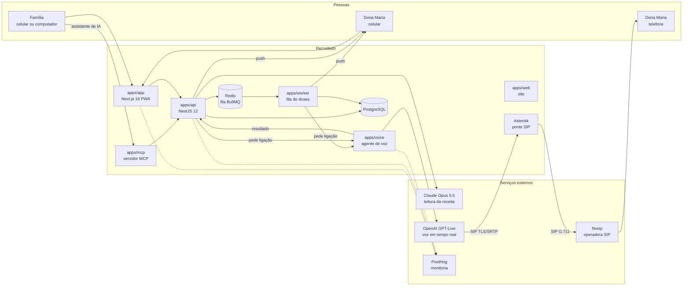
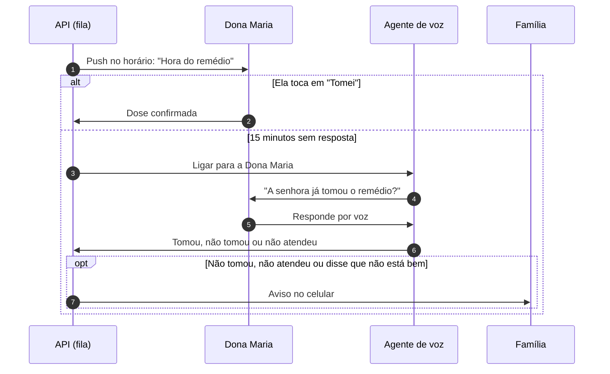

# Recuidado

[](https://github.com/lucianoiw/recuidado/actions/workflows/ci.yml)
[](LICENSE)

Agente de IA que cuida do remédio do idoso junto com a família.

O Recuidado lê a receita, mostra o que é de graça no Farmácia Popular, cota o resto com o teto da CMED e garante que a dose seja tomada. A Dona Maria recebe uma notificação no celular com um botão "Tomei". Se ela não confirmar, a IA liga para ela. Se mesmo assim não houver confirmação, a família é avisada.

Projeto do Hack Brasil 2026, trilha Saúde e bem-estar. Toda a demonstração usa dados fictícios. O Recuidado não faz diagnóstico, não recomenda tratamento e não altera dose.

- App: https://app.recuidado.com.br (a demonstração da Dona Maria abre sem login)
- Os dois celulares lado a lado, filho e mãe, com os apps de verdade: https://painel.recuidado.com.br
- Site: https://recuidado.com.br
- Contexto completo do projeto: [docs/context.md](docs/context.md)
- Painel de monitoria ao vivo (público, sem login): https://us.posthog.com/shared/agEAVqAn6xCM9GgdRycesljavVRvLg
- Como a monitoria funciona: [docs/monitoring.md](docs/monitoring.md)

## O que já funciona em produção

- **Receita lida por IA.** A família fotografa a receita e o Claude devolve cada remédio, dose e horário. A família revisa antes de salvar.
- **Lembrete no celular.** Notificação push no horário, com o botão "Tomei" na tela da Dona Maria.
- **Ligação de voz de verdade.** Sem confirmação, a IA liga para o telefone dela pela rede telefônica comum, pergunta como ela está e se tomou. Não precisa de app nem de internet do lado dela. Se ela disser que caiu ou está com dor no peito, a IA liga para o filho na mesma hora. Ver [Ligação para a Dona Maria](#ligação-para-a-dona-maria).
- **Família avisada.** Sem confirmação, ou se ela disser que não está bem, os filhos recebem o aviso na hora, por push e por e-mail. Todo aviso também fica na tela Avisos do app, com o sino de novos na tela Hoje. Ver [Avisos da família](#avisos-da-família).
- **A IA liga para a farmácia.** Em "Onde comprar", a família toca em "Perguntar à farmácia". A IA liga, se apresenta como assistente virtual, passa pelo menu de teclas (URA) sozinha, pergunta se tem e quanto custa a caixa do genérico e do referência, e a resposta aparece comparada ao teto da CMED. Ver [Ligação para a farmácia](#ligação-para-a-farmácia).
- **O que é grátis e onde.** Cada remédio é cruzado com a lista do Farmácia Popular, com o REMUME das UBS de São Paulo e com o Alto Custo, e a família vê as farmácias credenciadas mais perto.
- **Os irmãos dividem ou revezam.** Em "Onde comprar e dividir", a família escolhe: dividir todo mês (cada um manda a sua parte por Pix para quem comprou) ou cada mês um compra tudo, na ordem que eles escolheram. Quem paga outra coisa, como o plano de saúde, fica fora da conta. O app avisa todo mundo de quem é a vez. Ver [Dividir ou revezar a conta](#dividir-ou-revezar-a-conta).
- **Foto do remédio de verdade, nunca uma foto genérica.** O app da Dona Maria nunca mostra imagem de banco de comprimido: uma losartana de outro laboratório tem outra cor e outro formato, e uma foto parecida pode levar ela a tomar o remédio errado. Por isso o filho pode tirar, na aba Remédios, a foto da caixa ou do comprimido que ela tem em casa, e só essa foto aparece na tela da hora do remédio e em Meus remédios. Sem foto, a tela mostra só o nome, a dose e o horário. Ver [Foto do remédio](#foto-do-remédio).
- **Ligar para a família.** Se mais de um filho deixou o telefone, o botão do app dela vira "Ligar para a família" e abre uma tela com um botão grande para cada um ("Ligar para Ana", "Ligar para Carlos"). Com um filho só, o botão liga direto.
- **MCP para qualquer assistente de IA.** Claude, ChatGPT ou outro agente consulta o plano, as doses e os avisos da família por conversa. Ver [Servidor MCP](#servidor-mcp).
- **Login sem senha e a mãe sem cadastro.** O filho entra com o e-mail (código de 6 números ou link, pelo Resend). Os irmãos são convidados por e-mail. A mãe não se cadastra: o filho manda um link e o celular dela abre o app dela. Ver [Login e os dois celulares](#login-e-os-dois-celulares).
- **Monitoria completa.** Logs, erros, eventos, traces da IA e replay das telas em um só lugar (PostHog).

## Impacto

- **32,1 milhões de brasileiros têm 60 anos ou mais**, 15,8% da população ([Censo 2022, IBGE](https://agenciagov.ebc.com.br/noticias/202310/brasileiros-com-60-anos-ou-mais-superam-32-milhoes-de-pessoas-mdhc-reforca-importancia-do-cuidado-e-respeito-com-essa-faixa-etaria)).
- **93% dos idosos usam ao menos um remédio de uso contínuo e 18% usam cinco ou mais** ([PNAUM, Ramos et al., Rev Saúde Pública 2016](https://revistas.usp.br/rsp/en/article/view/126591)).
- **30,8% dos adultos com doença crônica no Brasil têm baixa adesão ao tratamento** ([PNAUM, Tavares et al., Rev Saúde Pública 2016](https://scielosp.org/article/rsp/2016.v50suppl2/10s)). Lembrar de tomar é uma das barreiras medidas.
- **Só 50% dos pacientes crônicos seguem o tratamento nos países desenvolvidos**, e menos nos países em desenvolvimento ([OMS, 2003](https://www.who.int/news/item/01-07-2003-failure-to-take-prescribed-medicine-for-chronic-diseases-is-a-massive-world-wide-problem)).
- **Mediana de 4,29% das internações hospitalares está associada a não adesão a remédios** (revisão de 24 estudos, [BMJ Quality & Safety 2018](https://qualitysafety.bmj.com/content/27/11/902.abstract)).
- **40% das pessoas que moram sozinhas no Brasil têm 60 anos ou mais** ([PNAD Contínua 2025, IBGE](https://istoedinheiro.com.br/cresce-numero-de-brasileiros-que-vivem-sozinhos-revela-ibge)).
- **O Farmácia Popular atendeu mais de 24 milhões de pessoas em 2024 e hoje entrega os 41 itens do catálogo de graça** ([Agência Gov, 2025](https://agenciagov.ebc.com.br/noticias/202502/farmacia-popular-beneficiou-mais-de-24-milhoes-de-brasileiros-em-2024-maior-numero-da-serie-historica)).

Todos os números, o contexto de cada um e os que deixamos de fora por falta de fonte confiável estão em [docs/impact.md](docs/impact.md).

## Arquitetura



| Parte | O que faz | Tecnologia |
| --- | --- | --- |
| `apps/app` | App instalável (PWA) em app.recuidado.com.br. A família cadastra a Dona Maria, lê a receita e acompanha as doses. A Dona Maria vê o remédio da hora e confirma com um toque. | Next.js 16, React 19, Tailwind 4, Web Push |
| `apps/web` | Site do produto em recuidado.com.br e www. Enquanto o site não fica pronto, manda todo acesso para o app mantendo o caminho, então links antigos continuam valendo. | Next.js 16 |
| `apps/api` | Família, remédios, doses, leitura de receita e escalonamento. Agenda lembrete, ligação e aviso em uma fila. | NestJS 12, PostgreSQL, Drizzle, Redis, BullMQ, Resend |
| `apps/worker` | Executa a fila na hora certa: lembrete, ligação, segunda ligação, aviso à família, ligação de volta, e agenda as doses de hora em hora. App próprio, com package.json, Dockerfile e imagem próprios, sem servidor HTTP e sem controllers: três arquivos (entrada, módulo e processador da fila). A API não consome a fila e não tem nada do worker. Separado para um não derrubar o outro, o deploy da API não parar a fila e cada um escalar sozinho. Os jobs ficam no Redis e sobrevivem a reinício. | NestJS 12 (application context), BullMQ |
| `apps/voice` | Liga para a Dona Maria, conversa por voz e devolve o resultado para a API. | OpenAI GPT-Live por SIP, Asterisk, Nvoip |
| `apps/mcp` | Servidor MCP sobre a API: qualquer assistente de IA consulta o plano, as doses, os avisos e onde o remédio é grátis. | MCP TypeScript SDK v2, Streamable HTTP |
| `packages/prescription-reader` | Leitura de receita (inclusive manuscrita) com saída estruturada. | Claude Opus 5.5 |
| `packages/data` | Coleta e cruzamento de dados públicos de remédios e farmácias. | Scripts Node, Firecrawl |
| `packages/core` | O que a API e o worker usam os dois: validação do ambiente, schema do banco, a fila e os serviços de cada passo (dose, pedido de ligação, aviso, push, e-mail, estoque). Uma implementação de cada passo; cada app importa só de `@recuidado/core`. | NestJS 12, Drizzle, BullMQ |
| `packages/telemetry` | Eventos, erros, traces de IA e exportação de logs para o PostHog. | posthog-node, OTLP |

## Servidor MCP

Endereço: `https://mcp.recuidado.com.br` (Streamable HTTP). Ao conectar, abre a tela "Conexão da família": um toque em Autorizar liga o assistente à família de demonstração, sem senha. Quem cadastrou a própria família cola o link do app dela (o mesmo que o filho manda para o celular da mãe), que só lê. Por baixo é OAuth 2.1 com PKCE, então o assistente só enxerga a família que foi conectada.

| Ferramenta | O que faz |
| --- | --- |
| `get_care_plan` | Remédios, horários, onde cada um é grátis (Farmácia Popular, UBS), Alto Custo, custo do mês e comprimidos restantes |
| `get_today_doses` | Doses de hoje: tomada, pendente ou perdida, como foi confirmada e se a família foi avisada |
| `confirm_dose` | Marca uma dose de hoje como tomada, igual ao botão "Tomei" |
| `list_family_alerts` | Avisos enviados à família: dose não confirmada, não está bem, remédio acabando |
| `find_free_medicine` | Busca um remédio e diz, por dosagem, onde é grátis e se entra no Alto Custo |

O telefone nunca sai nas respostas, e o servidor não dá conselho clínico. Detalhes em [apps/mcp/README.md](apps/mcp/README.md).

**Decisões e achados.**
- Serviço separado sobre a API pública, e não dentro da API: o MCP vê exatamente o que o app vê, e não conflita com o resto.
- SDK MCP v2 (especificação de 28/07/2026), sem estado. Clientes antigos (especificação de 2025) também funcionam; testado com os dois.
- Login de propósito simples, porque é prova de conceito com dados fictícios. Os tokens são assinados, nada fica guardado, e um redeploy não desconecta ninguém.
- Siri: pesquisado em 11/11/2026, não achamos fonte confiável de que a Siri do iOS 27 aceite servidor MCP pela URL. O caminho da Apple é App Intents, que exige app instalado. O mais perto hoje é usar o app do Claude ou do ChatGPT por voz com este conector.

**Como conectar.** No Claude: Configurações, Conectores, Adicionar conector personalizado, URL acima, e tocar em Autorizar. No Claude Code: `claude mcp add --transport http recuidado https://mcp.recuidado.com.br`.

**Casos de uso**

1. **Pergunta rápida no celular.** O filho pergunta ao Claude ou ao ChatGPT, por texto ou voz, até dirigindo: "a mãe tomou o remédio da pressão hoje?".
2. **Resumo automático.** Uma tarefa agendada no assistente, todo dia às 21h: "como foram as doses da mãe hoje e teve algum aviso?". O resumo chega sem abrir o app.
3. **Na consulta médica.** "Liste os remédios e horários da minha mãe." O assistente monta a lista para mostrar ao médico.
4. **Receita nova ou balcão da farmácia.** "Atorvastatina 20 mg é grátis?" A resposta diz se é grátis no Farmácia Popular, na UBS ou se entra no Alto Custo.
5. **Ela ligou e disse que tomou.** "Marca que ela tomou o das 8." A dose é confirmada e a ligação e o aviso daquela dose são cancelados.
6. **Agenda.** "Coloque os horários de remédio da mãe no meu Google Agenda." O assistente lê o Recuidado e grava na agenda do filho.
7. **Lista de compras.** "O que está acabando?" O que estiver acabando vai para a lista no Notion, no Todoist ou nas notas.
8. **Grupo da família.** O assistente escreve o resumo da semana para os irmãos, e o filho só envia.

Os casos 6 a 8 usam o conector do Recuidado junto com outro conector do mesmo assistente (agenda, notas). O Recuidado não acessa esses serviços.

## Login e os dois celulares

Decisões de 11/11/2026 (pedido do Luciano: profissionalizar o que foi feito em um dia).

- **Três endereços.** `app.recuidado.com.br` é o produto (`apps/app`). `recuidado.com.br` e `www` ficam para o site (`apps/web`); enquanto o site não fica pronto, ele manda todo acesso para o app mantendo o caminho, então links antigos continuam valendo. `painel.recuidado.com.br` mostra os dois celulares.
- **Filho entra com e-mail, sem senha.** O e-mail (Resend, remetente `avisos@recuidado.com.br`) traz um código de 6 números e um botão. O código existe porque no painel, e em quem lê o e-mail no computador, o link abriria em outra aba; digitar o código funciona dentro do celular. Vale 15 minutos, aceita 5 erros e até 6 pedidos por hora por e-mail. O banco guarda só o hash do código, do link e da sessão. Sessão de 60 dias.
- **Quem entra pela primeira vez cai no cadastro**, que agora exige o login: o e-mail do cadastro é o da sessão. Quem já tem família vai direto para Hoje.
- **Irmãos convidados por e-mail.** No passo "Quem cuida junto?" (e em Família, "Chamar mais alguém") vai o e-mail da pessoa. Ela recebe um link que vale 7 dias e já entra na família. Quem prefere mandar pelo WhatsApp manda o link `/entrar?convite=<família>&nome=<nome>`: a pessoa entra com o e-mail dela e assume o convite com aquele nome.
- **A mãe não se cadastra.** O filho abre Família, Celular dela, e manda o link `app.recuidado.com.br/m/<segredo>` (ou mostra o QR code). O celular dela guarda o segredo e abre o app dela. Esse link só lê e confirma dose; não muda remédio. O mesmo link conecta a família no MCP.
- **Dois logins no mesmo navegador sem misturar.** As telas `/patient` mandam só o link dela; as da família mandam só a sessão do filho. Por isso o painel funciona com os dois apps no mesmo navegador.
- **Visitante continua vendo a demonstração.** Sem login, o app mostra a família da Dona Maria, só leitura, como antes. O vídeo e os jurados não precisam de login (regulamento 7.2).
- **O painel** (`/painel`, servido pelo próprio app no domínio `painel`) põe os dois apps reais em molduras de Android: um Pixel 6 Pro para o filho e um Galaxy S8 para a mãe, desenhados em CSS pelo [devices.css](https://github.com/picturepan2/devices.css) (MIT). Cada celular tem uma barra de endereço: o filho copia o link dela à esquerda e cola no celular da mãe à direita. O app avisa o painel do endereço atual por `postMessage`, e "Começar de novo" apaga os dois logins. Notificação push não funciona dentro do painel (o navegador bloqueia em moldura); o lembrete aparece na tela dela do mesmo jeito.

## Foto do remédio

Decisão do Luciano de 12/11/2026, por segurança: a tela dela não mostra foto genérica de comprimido. A mesma substância muda de cor, formato e caixa conforme o laboratório, e a pessoa idosa reconhece o remédio pela aparência; uma foto parecida, mas diferente, pode fazer ela trocar um remédio por outro.

- A família abre o remédio em Remédios e toca em "Tirar foto". A câmera traseira abre direto. O app reduz a foto para no máximo 1280 px em JPEG antes de enviar (celulares tiram fotos de 4 a 12 MB).
- `PUT /family/medications/:id/photo` (multipart, campo `file`, JPG, PNG ou WEBP, até 8 MB) guarda a foto no Cloudflare R2 (`medication-photos/<família>/<remédio>/<id>.jpg`) e a chave em `medications.photo_key`. Uma foto nova apaga a antiga. `DELETE` tira a foto.
- `GET /family` devolve `photoUrl` em cada remédio: um link assinado do R2 que vale 12 horas, gerado sem chamar o R2. A foto não fica pública.
- O app dela mostra a foto grande acima do nome na hora do remédio e em Meus remédios. Sem foto, só nome, dose e horário, como antes.
- A família demonstração é só leitura, então a foto só pode ser tirada em uma família cadastrada. Para o vídeo, a Losartana da Dona Maria já vem com foto: uma caixa sintética (gerada por IA, sem marca real, `apps/api/assets/demo-losartana.jpg`), enviada ao R2 a cada início da API.

## Fluxo de uma dose



Os tempos são configuráveis (`DOSE_CALL_AFTER_MINUTES` e `DOSE_ALERT_AFTER_MINUTES`). Doses no mesmo horário são confirmadas juntas.

Modo demo: na tela Hoje da família, "Demo em 2 minutos" (`/family/demo`) cria uma dose extra de agora e roda esse mesmo fluxo com esperas em segundos (`DEMO_CALL_AFTER_SECONDS` e `DEMO_ALERT_AFTER_SECONDS`): lembrete, ligação de verdade e aviso para a família. A tela mostra cada passo e o que foi dito na ligação. A agenda normal não muda, e os eventos dessa dose vão para o PostHog com `demo: true`. `DEMO_RUN_ENABLED=false` desliga o botão.

### Remédio cadastrado no meio do dia (12/11/2026)

Antes, quem cadastrava às 12h não via as doses das 8h: só as próximas eram criadas, e o app dela dizia "tudo certo". Agora, ao salvar um remédio, os horários de hoje que já passaram também viram dose, sem lembrete, sem ligação e sem aviso para a família (`DosesService.addEarlierToday`). A API marca essas doses com `beforeAdded` (horário anterior ao cadastro do remédio). O app dela pergunta uma por horário: "Sim, tomei" grava como tomada; "Não tomei" (`POST /doses/:id/not-taken`) só anota, sem nenhum conselho sobre a dose. A família vê "Perguntando a ela" até a resposta.

### Tela da família atualiza em cerca de 2 segundos

Medido no código antes da mudança: as telas recarregavam `GET /family` a cada 30 s, então o "Tomei" dela levava de 0 a 30 s para aparecer no celular do filho. Agora cada tela aberta pergunta a cada 2 s `GET /family/changes`, que devolve só um carimbo (md5 das doses de hoje, dos remédios e dos avisos), e recarrega tudo apenas quando ele muda. Com a tela escondida não pergunta; ao voltar, recarrega na hora. Escolhemos isso no lugar de SSE ou WebSocket porque a confirmação pode vir da API, do worker ou da ligação, a autenticação vai em cabeçalho (que o `EventSource` não manda) e o proxy do Coolify não precisa de nada novo. Custo: uma consulta pequena a cada 2 s por tela aberta.

## Avisos da família

Toda mensagem para os cuidadores sai por push e por e-mail ao mesmo tempo e também fica salva (`alerts`) e aparece em `/family/avisos`, do mais novo para o mais antigo, agrupada por dia. Na tela Hoje, o sino mostra quantos avisos chegaram desde a última vez que a pessoa abriu a tela (contado no aparelho).

| Tipo | Quando |
| --- | --- |
| Dose não confirmada | Ninguém tocou em "Tomei" e a ligação não confirmou |
| Disse que não está bem | Na ligação, qualquer queixa, com as palavras dela |
| Emergência | Queda, dor no peito, falta de ar ou desmaio na ligação (push urgente) |
| Ligação para a família | A ligação de voz para o primeiro contato (ou para o próximo, se ele não atender), com o recado dito (sem push) |
| Ligação de volta | Resultado da ligação para ela depois da emergência |
| Remédio acabando | Estoque para `LOW_STOCK_DAYS` dias ou menos |
| Vez de comprar | No rodízio, uma vez por mês: quem compra este mês e quem é o próximo |

Cada aviso diz por onde chegou ("Notificação em 2 celulares e e-mail para 2 pessoas", "Por ligação de voz", ou "Só no app" quando ninguém ligou a notificação nem deu e-mail).

**E-mail com Resend (tecnologia de patrocinador do Hack Brasil).** O cuidador informa o e-mail no cadastro (opcional). Todo aviso que vai por push também vai por e-mail, enviado pelo Resend a partir de `avisos@recuidado.com.br` (domínio verificado com SPF e DKIM no Cloudflare). Cada pessoa recebe o próprio e-mail, sem ver os outros endereços, com o mesmo título e texto do push e um botão que abre a tela de avisos. Por que e-mail além do push: o push não chega no iPhone sem o app na Tela de Início, nem em quem negou a permissão, e some quando a pessoa limpa as notificações. O e-mail chega em qualquer celular ou computador e fica na caixa de entrada. Uma falha do Resend nunca impede o push nem o registro do aviso. A Família Demo é sintética e não tem e-mail: os avisos dela vão para `DEMO_ALERT_EMAILS`, um endereço da equipe configurado só no servidor. Envio e falhas vão para o PostHog (`alert_email_sent`, `alert_email_failed`).

**Por que uma tela e não só o push (decidido em 11/11).** O push some quando a pessoa toca nele ou limpa as notificações, chega só em quem permitiu e não chega em aba anônima nem no iPhone sem o app na Tela de Início. A tela deixa qualquer filho ver depois o que aconteceu, inclusive quem entrou na família depois. Ela também mostra que o aviso é independente do canal: o mesmo título e texto salvos em `alerts` podem sair por WhatsApp no futuro (por exemplo, com mensagem de modelo aprovada na API oficial), sem mudar o fluxo. Para o hackathon os canais são o push e o e-mail, pelo mesmo motivo da ligação: WhatsApp exige conta oficial verificada e aprovação de modelos que não cabem no prazo.

## Ligação para a Dona Maria

Uma conversa curta e calorosa, feita para uma pessoa idosa ao telefone.

- **Roteiro (revisado frase por frase pelo Luciano em 11/11).** "Oi, Dona Maria, bom dia! Aqui é a assistente virtual da Recuidado. Como a senhora está?". Ela responde, a IA reage curto ("Que bom!", e "Estou bem também, obrigada" só se ela perguntar) e pergunta "A senhora já tomou a Losartana das duas da tarde?". O horário é dito por extenso ("das duas da tarde"), porque "às 14:00" soa como se perguntasse se tomou exatamente naquela hora. Com 3 ou mais remédios no horário, pergunta pelos "remédios das duas da tarde" em vez de ler a lista. Para ela a IA diz "remédio", nunca "medicamento". Se tomou: "Obrigada, tchau!". O nome dela aparece só na saudação e no começo da resposta: no teste de 11/11, repetir "Dona Maria" em toda frase soou artificial.
- **Senhor ou senhora.** O cadastro tem "Na ligação, a assistente fala: A senhora / O senhor" (`members.gender`, padrão senhora). Muda o tratamento nas falas para ele e o "ele/ela" na fala para o filho.
- **Ainda não tomou.** A IA pede "A senhora pode tomar agora, por favor?". Se ela confirma na hora, conta como tomado. Se não, "Tá bom, Dona Maria, daqui a pouco eu ligo para confirmar. Obrigada, tchau!", e a Recuidado liga de novo depois de `DOSE_RECALL_MINUTES` (15 min): "Oi, Dona Maria! É a assistente virtual da Recuidado de novo. A senhora já tomou a Losartana das duas da tarde?". Só se na segunda ligação ela ainda não tomou ("Tá bom, Dona Maria. Não esqueça de tomar, viu? Obrigada, tchau!") a família é avisada. Avaliamos ficar na linha esperando ela tomar e descartamos: custa minuto, deixa silêncio na ligação e o modelo tende a desligar ou falar sem necessidade. A ligação do modo demo (2 min) não tem segunda ligação, para o vídeo caber no tempo.
- **Sem silêncio no começo.** O GPT-Live leva cerca de 3,6 s para começar a falar depois que a pessoa atende (medido). Na primeira ligação, o serviço de voz grava a saudação na própria voz da IA. Nas seguintes, toca essa gravação no instante em que ela atende, e a IA continua a conversa ao vivo. É uma gravação por nome, período (bom dia, boa tarde, boa noite) e voz.
- **Sem conta de telefone à toa.** A IA diz o tchau junto com o registro da resposta. Depois espera até 3 s pela despedida dela e desliga 1 s após ela parar de falar, porque muitos idosos não desligam.
- **Como ela está.** Qualquer queixa, até cansaço ou tontura, vira um aviso por push para a família, com as palavras dela. A IA não dá conselho de saúde: só diz "Poxa. Vou avisar a sua família." e segue para o remédio. Cansaço sozinho não é emergência: idoso diz "tô cansada" com frequência, e ligar para o filho a cada vez seria alarme falso.
- **Emergência.** Queda, dor no peito, falta de ar, desmaio ou fraqueza a ponto de não levantar: a IA não pergunta do remédio, diz só "Entendi." enquanto registra a resposta, e o código manda a frase, com calma e sem "ai, meu Deus" (antes ela improvisava "calma, um momento" e depois repetia): "Entendi. Vou avisar a sua família e já te ligo de volta para saber como a senhora está, tá bom? Até já.". Desliga na hora, para a linha dela ficar livre para o filho ligar.
  - A família recebe um push urgente. O primeiro contato (só ele, para não causar alarde; o próximo só se ele não atender) recebe uma ligação que conta, em terceira pessoa, o que ela disse: "Olá, aqui é a assistente virtual da Recuidado. Eu conversei com Dona Maria e ela falou que caiu no banheiro. Seria interessante você ligar para ela agora. Se for grave, ligue para o SAMU, 192." No começo a ligação repetia as palavras exatas dela entre aspas ("ela disse: Eu caí no banheiro"). No teste, a voz da IA lendo a fala de outra pessoa soou como deboche, então agora o modelo que registra a resposta escreve um resumo curto em terceira pessoa ("caiu no banheiro") e a ligação conta esse resumo. O serviço de voz considera o recado entregue quando ouve o SAMU e desliga 2,5 s depois.
  - Depois de `EMERGENCY_CHECKIN_MINUTES` (10 min, tempo para o filho ligar antes) a Recuidado liga de volta: "Oi, Dona Maria! É a assistente virtual da Recuidado de novo. A senhora está melhor?". Depois da resposta a IA diz só "Entendi." e o código manda a frase certa, escolhida pelo modelo que registra a resposta. No teste, quando a IA respondia sozinha, ela improvisava ("Já vou chamar sua família") e depois a frase exigida vinha em seguida, repetindo o aviso.
  - Se ela está melhor ou alguém da família já está com ela ("meu filho já veio"): "Que bom! Fico mais tranquila. Se cuida, tchau!". A família recebe um push com o que ela disse, e acabou.
  - Se ela ainda não está bem: "Vou avisar a sua família de novo e já te ligo. Até já!". O primeiro contato recebe outra ligação ("Liguei de novo para Dona Maria e ela falou que ainda está com dor. Seria interessante você ligar para ela agora...") e a Recuidado liga de novo para ela, até 3 vezes. Se ela não atende: "Liguei de novo para Dona Maria e ela não atendeu. Seria interessante você ligar para ela agora. Se for grave, ligue para o SAMU, 192." O SAMU fica também aqui de propósito: não atender depois de uma queda é o caso mais grave.
  - Garantia no código: o modelo nem sempre segue o prompt (em teste ele respondeu uma queda com "Já volto. Tchau"). Se a resposta registrada é emergência e ela não ouviu "vou avisar a sua família", o serviço de voz manda a frase exata e só desliga depois do tchau ou do "até já".
- **Primeiro contato.** A família escolhe, na aba Família, quem recebe a ligação de emergência (`members.emergency_contact`, `PUT /family/members/:id/emergency-contact`). Ligar para todos os filhos ao mesmo tempo causaria alarde e várias pessoas ligando para a mesma linha; os outros recebem só o push. Sem escolha, é quem fez o cadastro (o cuidador mais antigo com celular). Na família demo, o Carlos é o primeiro contato, e a API volta a marcá-lo a cada reinício.
- **Se o primeiro contato não atende, liga para o próximo** (pedido do Luciano, 12/11). Ligar só para um evita alarde, mas se ele não atender ninguém fica sabendo pela voz. Agora a Recuidado liga para um de cada vez, na ordem: primeiro contato, depois os outros cuidadores com celular por ordem de cadastro, até alguém ouvir o recado. Como funciona: o serviço de voz avisa a API quando a ligação para o filho termina (`POST /doses/:id/alert-call-result`, com `delivered`). Se o recado não foi ouvido até o SAMU, a API põe um job `next-contact` na fila e o worker liga para o próximo, com o mesmo recado. O id do job é o id da ligação, então o serviço de voz pode repetir o POST sem gerar ligação dobrada. Caixa postal não conta como ouvido: se o filho recusa a chamada, a operadora atende com a caixa postal e a IA leria o recado para uma gravação. Por isso a ligação escuta o outro lado e, se ouvir "caixa postal", "deixe sua mensagem", "após o sinal", "fora da área" ou parecido, desliga e passa para o próximo. Número fora do `CALL_ALLOWED_NUMBERS` é pulado na hora. Cada pessoa recebe no máximo uma ligação por rodada, e a rodada acaba no último da lista. Se ninguém ouvir, a família recebe um push urgente: "Ninguém da família atendeu a ligação de emergência. Ligamos para Carlos e Ana e ninguém ouviu o recado. Ligue para ela agora. Se for grave, ligue para o SAMU, 192." Em Avisos aparece "Carlos não atendeu. Ligamos para Ana". Limitação conhecida: se a operadora atender com uma gravação que não usa essas palavras, o sistema acha que alguém ouviu.
- **Ligação calma quando ela não toma ou não atende** (pedido do Luciano, 12/11). Antes, quando a dose não era confirmada na ligação (ela não atendeu, ou na segunda ligação ainda não tinha tomado), a família recebia só o push. Agora o primeiro contato também recebe uma ligação, na mesma ordem e com a mesma passagem para o próximo se ninguém ouvir, mas sem tom de urgência e sem SAMU: "Olá, Carlos, tudo bem? Aqui é da Recuidado. Tentei falar com Dona Maria e não consegui contato. Por favor, tente entrar em contato com ela. Obrigado." Se ela atendeu e disse que ainda não tomou: "Falei com Dona Maria e ela ainda não tomou o medicamento." Cada filho ouve o próprio nome: o recado viaja com o espaço `{nome}`, preenchido para cada pessoa. O serviço de voz considera o recado ouvido quando a IA chega ao "Obrigado" (na emergência, ao SAMU). Se ninguém ouvir, não há push extra, porque o push de dose não confirmada já pediu para ligar para ela.
- **Caixa postal e triagem.** Mensagem de caixa postal encerra a ligação como "não atendeu". Para o assistente de triagem do celular, a IA se apresenta como "Recuidado, lembrete do remédio".
- **Por baixo.** GPT-Live (voz `bossa`, português do Brasil) disca por SIP com TLS e SRTP para um Asterisk na VPS, que converte o áudio e repassa para a Nvoip. Um modelo delegado com raciocínio baixo grava a resposta em cerca de 1 s. Cada ligação fica no Postgres (`voice_calls`) com transcrição, resultado e motivo do fim.

- **Por que telefone e não ligação pelo WhatsApp (decidido em 11/11).** Avaliamos a ligação iniciada pela empresa da API de ligações do WhatsApp (Cloud API Calling). Ela existe no Brasil, custa cerca de US$ 0,011 por minuto e aceita SIP com TLS, SRTP (SDES) e G.711 ou Opus, então o nosso Asterisk conseguiria ligar o GPT-Live a ela. Ficou fora por três motivos: (1) a Meta exige limite de mensagens de pelo menos 2.000 destinatários por dia no número da empresa, o que pede conta oficial e verificação que não cabem no prazo; o número de teste da Meta dispensa esse limite, mas é dos EUA, onde a ligação iniciada pela empresa não é permitida, e não confirmamos se o teste abre exceção; (2) a Dona Maria precisaria aceitar antes um pedido de permissão no WhatsApp, e 4 ligações seguidas sem atender revogam essa permissão, o que é comum com idoso; (3) o telefone comum chega a qualquer pessoa, sem app nem internet. A falha vista nos testes de emergência era de uma linha específica, não da arquitetura. A ligação pelo WhatsApp fica no roadmap como canal extra para quem já usa WhatsApp.

## Ligação para a farmácia

O agente não só lembra: ele executa no mundo real. Liga para a farmácia, pergunta e traz a resposta como dado.

- **Roteiro.** Espera o outro lado falar. A primeira frase para uma pessoa é sempre "Aqui é a assistente virtual da Recuidado, ligando em nome de uma família". Pergunta, para até 3 remédios, estoque e preço da caixa do genérico e do referência (e qual dos dois eles têm). O card mostra os dois preços e compara o mais barato com o teto da CMED. Nunca compra, reserva ou passa dado pessoal.
- **Não pergunta sobre o Farmácia Popular (decisão de 12/11/2026).** O app já sabe o que é grátis lá (lista oficial de códigos de barras, `pfpb-free-items.json`) e quais farmácias são credenciadas (painel do Ministério da Saúde "Consulta de Endereço das Farmácias", atualizado todo dia, cruzado pelo CNPJ com o CNES em `pharmacies.json`, campo `fp_accredited`). A ligação só cobre o que não é público: estoque e preço do remédio que a família paga. Os remédios grátis nem entram na ligação.
- **Menu de teclas (URA).** O GPT-Live envia DTMF pelo SIP (evento `transport.dtmf.send` no sideband): uma tecla por evento, e o Asterisk repassa para a Nvoip (RFC 4733). Quem escolhe a tecla é o nosso código: ele lê a transcrição do menu e, quando o menu faz uma pausa, aperta a opção de preço e estoque (ou atendente, ou remédios). A ferramenta `press_phone_keys` do modelo fica como reserva para menus que a regra não entende.
- **Resposta gravada em duas camadas.** O modelo deve dizer o tchau e, ao mesmo tempo, chamar `record_pharmacy_answer`. Se a ligação termina sem esse registro, o Claude (Sonnet 5.5) lê a transcrição e preenche estoque e preço da caixa do genérico e do referência, sem calcular nem chutar preço. Enquanto ele lê (cerca de 4 s), o card continua em "ligando".
- **Comparação com a CMED.** O preço dito por telefone é comparado ao teto da CMED por comprimido ("Dentro do teto" ou "Acima do teto"). A tela diz que preço por telefone é referência, não oferta.
- **Sem ligar para terceiros.** Só disca `PHARMACY_CALL_PHONE`, que precisa estar listado um a um na whitelist (`*` não vale para farmácia). O Asterisk atende `+5500000000000` (DDD 00 não existe) com uma URA de teste: menu com voz sintética e uma atendente gravada. As falas são geradas com o Piper (TTS neural, offline e grátis, vozes pt-BR faber e cadu) por `deploy/asterisk/sounds/make.sh`; antes eram do espeak-ng, robótico demais para entender ao telefone. Assim a demo mostra a ligação inteira, com teclas, sem incomodar uma farmácia de verdade. As ligações para farmácia contam nos mesmos limites diários.
- **Achados de 8 ligações reais à URA de teste (11/11).** O modelo de voz é instável com menus e ferramentas, então cada falha virou uma regra no nosso código:
  - Ela falou com o menu gravado e, quando a atendente falou primeiro, pulou a frase de assistente virtual. Agora o código detecta o menu e manda a apresentação quando uma pessoa fala e faz uma pausa.
  - Em uma ligação ela disse "Opção 2" em voz alta em vez de apertar a tecla, e o menu repetiu por 177 s. Em outra, apertou a tecla errada. Agora a tecla é escolhida por regra (palavras "preço", "estoque", "atendente").
  - Nas três últimas ligações ela se despediu sem chamar a ferramenta de registro, e a atendente desligou. A leitura da transcrição pelo Claude recuperou a resposta certa nas duas em que já existia.
  - Resultado final (8ª ligação): menu, tecla 2, apresentação, pergunta, resposta "tem, R$ 32,50, caixa com 30, sai pelo Farmácia Popular" e tchau, em 46 s.
- **Problema que sobrou (resolvido em 11/11, ver abaixo).** O modelo falava com o menu ("Um instante, vou escolher a opção") antes da tecla sair, e às vezes falava por cima da atendente.
- **Como outras empresas resolvem (pesquisa de 11/11).** Ninguém confia no modelo de conversa para lidar com o menu sozinho:
  - **Classificar fora da conversa.** O LiveKit roda a detecção (pessoa, URA, caixa postal) fora do agente, com um LLM lendo a transcrição: mediana de 840 ms, F1 de 98,2% para URA, e na dúvida trata como pessoa ([LiveKit](https://livekit.com/blog/answering-machine-detection)). O Pipecat tem um modo URA separado do modo conversa e troca o prompt quando detecta uma pessoa ([Pipecat](https://docs.pipecat.ai/pipecat/fundamentals/ivr)).
  - **Esperar o menu acabar.** Pausa antes de apertar: Retell 1 s por padrão (até 5 s) ([Retell](https://docs.retellai.com/build/single-multi-prompt/press-digit)); Pipecat espera 2 s de silêncio no modo URA e 0,8 s com pessoa; Vapi deixa o turno mais lento nos primeiros 30 s da ligação e manda o modelo responder com um espaço (silêncio) enquanto o menu fala ([Vapi](https://docs.vapi.ai/ivr-navigation)). Tecla apertada no meio do menu é ignorada por muitas URAs; o Retell diz que o tempo errado leva ao setor errado em cerca de um terço das URAs comuns ([Retell](https://www.retellai.com/blog/how-voice-ai-handles-hardest-parts-real-call)).
  - **Tecla como evento RFC 4733**, não como som, e intervalo de 3 s entre teclas do modelo (LiveKit, [receita](https://docs.livekit.io/reference/recipes/ivr-navigator)). Já fazemos as duas coisas.
  - **Silêncio na espera e memória do caminho.** A Sierra diz que o mais difícil é ficar quieto na espera e perceber quando a pessoa atende; ela guarda qual caminho funciona em cada empresa, e com isso subiu o acerto de 57% para 85% ([Sierra](https://sierra.ai/blog/navigating-ivr-systems)).
- **O que o GPT-Live permite (documentação da OpenAI).** Não tem evento para calar a saída do modelo, nem para cancelar a fala, nem ajuste de turno ([controles do servidor](https://developers.openai.com/api/docs/guides/voice-server-controls)). Ele é full duplex: fala e ouve ao mesmo tempo ([conversas](https://developers.openai.com/api/docs/guides/live-conversations)). O que existe: `session.instructions.append` pode interromper a fala em andamento; `session.output_audio.fixture.play` interrompe a fala, mas também descarta o que o outro lado diz enquanto toca; e os gatilhos de Decisions (`session.triggers`) fazem perguntas de escolha a cada trecho da transcrição ([sideband](https://developers.openai.com/api/reference/resources/live/sideband-websocket), [Decisions](https://developers.openai.com/ja-JP/api/docs/guides/decisions-voice)). Ou seja: com o GPT-Live, o jeito garantido de ele não falar com o menu é ele não ouvir o menu.
- **Descartado: cadastrar o caminho do menu por farmácia.** Não funciona ligando para uma farmácia qualquer, que é o que o produto precisa fazer.
- **Feito (11/11, PRs #121, #124, #125 e #127): duas IAs e uma trava de voz.** É o padrão do LiveKit e do Pipecat: uma segunda IA lê o que o outro lado diz e classifica, e a fala do agente fica presa até o veredito; na dúvida, pessoa ([Evalgent](https://www.evalgent.com/blog/voicemail-detection-livekit-pipecat)).
  - **Segunda IA.** Um gatilho de Decisions do próprio GPT-Live (`session.triggers`) responde a cada trecho da transcrição duas perguntas de escolha: o que é o outro lado (menu, espera, pessoa, pessoa pedindo um minuto, fechado, caixa postal, incerto) e qual tecla do menu leva a preço e estoque. Ele não precisa de um modelo de transcrição à parte, porque lê a transcrição que o GPT-Live já faz. Antes dele, regras por palavra ("tecle", "aguarde", "horário de atendimento") dão a resposta na hora quando são óbvias. Desligável com `PHARMACY_DECISIONS=false`.
  - **Trava de voz.** O Asterisk está no meio de todo o áudio. Pelo AMI (`ASTERISK_AMI_SECRET`, porta 5038, só rede privada), o serviço de voz chama `MuteAudio` no canal da ligação: cala o que a IA fala para a farmácia e mantém o que ela ouve ([Asterisk](https://docs.asterisk.org/Latest_API/API_Documentation/AMI_Actions/MuteAudio/)). A ligação começa com a IA calada. As teclas (DTMF) passam com a trava ligada (testado).
  - **O que o código faz com cada veredito.** Menu: continua calada, espera o menu acabar e aperta só uma tecla que o menu ofereceu. Espera com música: calada. Pessoa: solta a voz e se apresenta 1,2 s depois que a pessoa para de falar. "Só um minuto": solta, diz só "Claro, eu aguardo." e cala de novo até a pessoa voltar. Fechado: desliga e grava "A farmácia estava fechada (mensagem gravada)". Caixa postal: desliga.
  - **Latência medida.** O Decisions respondeu entre 79 e 460 ms (mediana de cerca de 160 ms), bem abaixo dos 840 ms do LiveKit.
  - **Teste nos 5 cenários (11/11, URA de teste no Asterisk).** Cada número de teste simula um tipo de farmácia (`+55000000000` seguido de 00 a 04):

    | Cenário | Resultado |
    | --- | --- |
    | Menu de teclas | Tecla 2, apresentação, resposta gravada, 45 s |
    | Menu, depois espera com música | Calada no menu e na espera, tecla 2, resposta gravada, 83 s |
    | Pessoa diz "só um minutinho" | "Claro, eu aguardo.", calada, apresentação depois do "Pronto, desculpa a demora", 48 s |
    | Pessoa atende direto | Apresentação, resposta gravada, 73 s |
    | Farmácia fechada (mensagem gravada) | Reconheceu em 6 s, desligou, card com "fechada" |

  - **Achado: a transcrição perde a saudação curta.** Duas vezes, o "Farmácia Teste, boa tarde" logo depois da música de espera (ou logo no começo) não apareceu na transcrição, e a IA só se apresentou quando a atendente repetiu "Alô?". Uma atendente de verdade faz isso quando a linha fica muda, e a atendente de teste agora também faz (PR #127). Do fim da saudação até a IA falar leva cerca de 3 s: a transcrição de uma frase curta chega em 1,5 a 2 s e a IA espera 1,2 s de pausa para não cortar a pessoa.
  - **Falta.** Testar com uma farmácia de verdade (depende de ok do Luciano, regra de não ligar para terceiros) e com música de espera real, que é diferente do tom sintético do teste.
- **Três farmácias simuladas (12/11, PRs #143 a #186).** Decisão do Luciano: não ligar para farmácia de verdade por enquanto. O botão "Perguntar às farmácias" liga para três farmácias ao mesmo tempo (`PHARMACY_CALL_TARGETS`, "Nome|número" separados por vírgula) e o app compara os preços, com a conversa de cada uma e a gravação no painel.
  - **Quem atende.** O menu é um menu de verdade no Asterisk (voz sintética). Quem atende é uma segunda sessão do GPT-Live com voz masculina (`PHARMACY_ACTOR_VOICE`, padrão `tempo`), e a assistente do produto continua com a voz feminina `bossa`. Cada atendente sabe só os preços da sua farmácia, calculados a partir da caixa da CMED (`apps/voice/src/sim-pharmacy.ts`): Drogaria Vida (menu, tecla 2, 0,9 do teto), Farmácia Central (atende direto, 0,65 do teto) e Drogaria Bom Preço (menu com boas-vindas, tecla 3, espera com música, 1,15 do teto, acima da CMED de propósito).
  - **Como as duas IAs se encontram.** `+550000000001N` é a farmácia N. Quando a assistente passa pelo menu, o Asterisk marca `SIM_READY_N` e toca chamando; o serviço de voz vê isso pelo AMI e só então disca o atendente em `+550000000009N`, que entra em uma ConfBridge `simN` com a assistente. Discar o atendente no começo não funcionou: ele desistia de esperar durante um menu longo.
  - **Achados das rodadas.** "Você ligou para a Drogaria X" é boas-vindas gravada, não pessoa (a IA se apresentava por cima do menu). "Bom Preço" fazia a regra achar que a primeira opção era de preço: agora a regra lê só o nome da opção depois de "para". Quando o atendente fica 9 s quieto depois da pergunta, a assistente diz "Alô? Vocês estão me ouvindo?" (até 2 vezes). Uma vez o GPT-Live devolveu `invalid_request_error` no turno seguinte a uma tecla e a ferramenta de registro não rodou: agora a ligação desliga no tchau mesmo assim e o Claude lê os preços da transcrição.
  - **Rodadas medidas (12/11, PRs #159 a #186).** Cada rodada liga para as três ao mesmo tempo; `measure.py` confere status, duração, preços, quantas vezes a assistente se apresentou e quantos "Alô?". As ligações de produção foram apagadas antes (`WIPE_CALLS_ON_BOOT`, uma vez por rótulo, como `WIPE_DATA_ON_BOOT`). Ligações para farmácias simuladas (DDD 00) não contam no limite diário (`pharmacy_inquiries.simulated`).

    | Rodadas | Ligações | Os dois preços certos | O que apareceu |
    | --- | --- | --- | --- |
    | 16:21 a 16:41 | 21 | 21 | 4 ficaram abertas até o limite de 3 min porque a assistente se calou depois da resposta |
    | 16:47 a 17:07 | 24 | 22 | Asterisk reiniciou sozinho no meio de uma rodada; um preço errado na leitura |
    | 17:19 a 17:24 | 9 | 7 | Linha muda depois da tecla por 3 min; atendente simulado trocou o preço do genérico |
    | 17:38 a 17:45 | 15 | 9 | Atendente simulado mudo depois da pergunta ou respondendo pela metade |
    | 17:59 a 18:05 | 12 | 12 | Uma apresentação repetida; duas terminaram sem "tchau" |
    | 18:10 a 18:19 | 15 | 15 | Uma ficou aberta até 3 min (a IA se apresentou sozinha depois do "Alô?" e o vigia de silêncio não contava isso, corrigido no #182). Uma vez a assistente inventou uma frase fora do assunto ("olha só essa calça...") e o atendente ouviu |
    | 18:39 a 18:44 | 12 | 10 | Duas vezes o "Alô?" saiu junto com o "boa tarde" do atendente: ele ouviu só pedaços, perguntou "Qual remédio?" e a transcrição da assistente perdeu isso. Agora, antes de desligar por silêncio, a assistente pergunta de novo uma vez (#186). Um preço de referência lido como "3,90" |
    | 18:50 a 18:55 | 15 | 13 | Todas terminaram com "tchau". As duas erradas: o atendente disse "treze e noventa" (registro do atendente) e a transcrição da assistente ouviu "três e noventa". Isso também aconteceria com uma pessoa na linha |

    Chamadas de 26 a 74 s (Farmácia Central cerca de 30 s, Drogaria Vida e Bom Preço 50 a 70 s por causa do menu e da espera).
  - **Correções que as rodadas pediram.**
    - Apresentação só conta quando a farmácia ouve: o que a IA fala com o áudio fechado fica fora da conversa e ela repete quando o áudio abre, esperando ela terminar a frase (#159, #164, #166, #168, #169).
    - Depois de uma tecla ou da espera, 9 s de silêncio: a assistente diz "Alô?" (até 3 vezes). Se nada foi ouvido desde a tecla, desliga como `silent_line` (#162, #176).
    - Assistente calada 6 s depois que a farmácia respondeu: um lembrete para registrar ou perguntar; se continuar calada, desliga e o Claude lê os preços da transcrição (#166). Resposta registrada sem "tchau": pede o "tchau" uma vez (#179).
    - 25 s sem ouvir nada depois da apresentação: desliga (#171). Veio de uma ligação que ficou muda depois de o Asterisk de teste reiniciar sozinho (causa não encontrada).
    - A assistente repete os dois preços de cada remédio logo que o atendente fala, enquanto ele lembra ("Então o genérico treze e noventa e o de referência vinte e quatro e noventa, certo?"), porque a linha confunde "treze" com "três". Se ele corrige, vale o preço corrigido, também na leitura da transcrição pelo Claude (decisão do Luciano, 12/11, #191). Conferir só os preços "fora da média" foi descartado: o teto da CMED não é média e genérico pode sair muito abaixo dele.
    - Sem limite de 3 remédios por ligação (decisão do Luciano, 12/11): a família pergunta por todos os que escolher; a ligação ganha 40 s de limite por remédio a mais. Para a demo, três remédios bem escolhidos (um comum, um caro, um em falta). Ideia para depois: com muitos remédios, a assistente oferece mandar a lista por e-mail ou WhatsApp para o atendente.
    - Próximos testes e perguntas (pedido do Luciano, 12/11, depois da POC): (1) testar farmácia com só o genérico, só o de referência (remédio sem genérico, sempre preço cheio) e nenhum dos dois; hoje os atendentes simulados sempre têm os dois. (2) No fim de toda ligação, perguntar se a farmácia cobre oferta de outra farmácia: com várias farmácias pesquisadas, o app mostra a mais barata e quem cobre oferta, e a família compra tudo em uma só.
    - Medido com 3 remédios (Losartana, Rosuvastatina e Sacubitril valsartana; Rosuvastatina em falta na Bom Preço e Sacubitril em falta na Vida), 6 rodadas em 12/11 à noite: 52 de 54 respostas certas (estoque e os dois preços), 80 a 140 s por ligação. As 2 erradas vieram do atendente simulado: uma vez disse "duzentos e trinta e quatro" e "trezentos e vinte e dois e cinquenta" no lugar de 234,90 e 422,90 (a assistente repetiu, ele pediu para esperar e não confirmou), e outra vez não deu o preço do genérico. Com 1 remédio, as 9 ligações depois do #194 vieram certas. Uma vez a assistente "confirmou" o preço do exemplo das instruções antes de o atendente falar; o exemplo agora não tem números (#194). Uma ligação de 3 remédios ficou 4 min parada: a linha cortou "duzentos e trinta e quatro e noventa" e a assistente repetiu o preço errado, como devia; o atendente simulado disse "peraí, já te confirmo" e não voltou, e a espera não tinha limite. Agora, depois de 40 s de silêncio esperando, a assistente pergunta "Alô? Ainda está aí?" e encerra se ninguém responder; o atendente simulado confirma ou corrige o preço repetido (#197). Depois do #197 (12/11, 21:20 a 21:35): 3 rodadas de 1 remédio (9 de 9 ligações certas) e 3 rodadas de 3 remédios (27 de 27 respostas certas, 70 a 131 s por ligação), todas com "tchau".
    - O atendente simulado diz cada preço com o nome ("o genérico sai sete e noventa"), escrito por extenso nas instruções dele (#176). O serviço de voz registra o que o atendente fala e ouve (#178).
  - **O que ainda falha e por quê.** O GPT-Live às vezes continua falando sozinho com uma frase sem relação com a ligação (1 vez em 123 ligações medidas). Quase todas as outras falhas vêm de duas IAs conversando: uma fala por cima da outra, a transcrição corta o começo da frase ("Comprimidos" em vez do preço) ou o atendente simulado não responde. Com uma pessoa do outro lado, o que importa é a linha, e isso não muda. A transcrição da linha telefônica confunde "treze" com "três" (3 vezes em 123); por isso a assistente agora repete o preço para o atendente confirmar.

## Painel das ligações

[painel.recuidado.com.br/ligacoes](https://painel.recuidado.com.br/ligacoes) mostra cada ligação da família de demonstração: o áudio gravado, a conversa e o que o sistema fez em cada momento (a função que registrou a resposta com os argumentos, a frase garantida pelo código, as teclas e a classificação do outro lado na farmácia). Serve para o vídeo e para os jurados verem que a IA e o código trabalham juntos.

- **Gravação.** Toda ligação passa pelo Asterisk. Logo que a ligação é criada, o serviço de voz pede pelo AMI um `MixMonitor` no canal da IA (as duas vozes, WAV 16 kHz). É só uma cópia do áudio: a ligação não espera por ela, e a latência da voz não muda. Quando a ligação acaba, o Asterisk envia o arquivo para `POST /call-logs/:sessao/recording` em segundo plano (`deploy/asterisk/upload-recording.sh`), e a API guarda no Cloudflare R2 (`R2_*`), ou no Postgres se o R2 não estiver configurado.
- **Linha do tempo.** O serviço de voz guarda as linhas de log de cada ligação com o tempo desde o início e envia junto com a transcrição para `POST /call-logs`. A tela mostra os passos principais e, num clique, todos.
- **Privacidade.** Sem login, a lista e os áudios mostram só a família de demonstração (dados sintéticos, vozes da equipe). Com login, cada família vê só as próprias ligações. Transcrição, passos e áudio guardado no Postgres somem depois de `VOICE_TRANSCRIPT_RETENTION_DAYS`; no R2, por regra de ciclo de vida do bucket. Desligar: `RECORD_CALLS=off` no serviço de voz.

## Dividir ou revezar a conta

O que não sai grátis a família paga, e cada família combina de um jeito. O app aceita os dois jeitos mais comuns, escolhidos no cadastro (passo "Quem cuida junto?") ou depois em "Onde comprar e dividir":

- **Dividir todo mês.** Quem compra cadastra a chave Pix. Cada irmão vê a sua parte e um Pix "copia e cola" com o valor já preenchido, e toca em "Já paguei". A parte de quem comprou já conta como paga.
- **Cada mês um compra.** A família põe os irmãos em ordem (setas para subir e descer). O primeiro compra no mês atual, o segundo no mês seguinte, e assim por diante. A tela mostra de quem é a vez, o botão "Já comprei" e os próximos três meses. No começo de cada mês, todos recebem o aviso "Em dezembro, Carlos compra os remédios", por push e e-mail, com o nome do próximo.
- **Fora da conta.** Qualquer irmão pode ficar fora da divisão e do rodízio, com o motivo à vista ("Paga o plano de saúde"). Ele continua recebendo os avisos da mãe.

**Sem cobrança automática (decidido em 11/11).** O app não move dinheiro nem confere se o Pix caiu. Detectar o pagamento exigiria passar cada Pix por um intermediário (a AbacatePay cobra por transação) e todos os irmãos teriam de pagar por ele. Por isso o Pix é estático, direto para a chave de quem comprou, e cada um marca "Já paguei" ou "Já comprei". A AbacatePay fica só para a assinatura do plano pago.

Como funciona: `families.split_mode` (`split` ou `rotation`), `families.rotation_start_month` (o mês em que o primeiro da lista compra; muda quando a ordem muda) e, em cada cuidador, `members.rotation_order`, `split_excluded` e `split_excluded_reason`. A vez de cada mês é a posição na lista mais os meses desde o início, em volta da lista (`packages/core/src/rotation`). O aviso mensal sai do planejador de doses do worker, que roda a cada hora, e `families.rotation_notified_month` garante um aviso por mês. Quando alguém muda a ordem e muda quem compra no mês atual, o aviso sai na hora.

## Plano pago (AbacatePay)

O Recuidado é grátis em tudo que não custa nada a cada uso: leitura da receita, Farmácia Popular, preço CMED, divisão do custo com Pix e lembrete no celular. As ligações (lembrete, emergência e farmácia) são o único custo variável, porque cada minuto paga a linha (Nvoip) e o modelo de voz (GPT-Live). Por isso elas são o plano pago, **Recuidado Família**, R$ 19,90 por mês com 7 dias grátis. O preço é provisório até medirmos o custo por ligação.

- **Assinatura recorrente de verdade**, pela API v2 da AbacatePay: um produto mensal (`cycle: MONTHLY`, `trialDays: 7`) e um checkout de assinatura hospedado por ela (`POST /v2/subscriptions/create`). O id da família vai como `externalId`.
- **Webhook** em `POST /billing/webhook`: `subscription.completed` e `trial_started` ativam, `renewed` mantém, `cancelled` desliga. A origem é provada pelo secret do webhook, comparado em tempo constante. `payment_failed` não desliga nada, porque a AbacatePay tenta de novo e cancela sozinha quando as tentativas acabam.
- **Bloqueio das ligações** (`PlanGate`, `packages/core/src/billing`): o worker e a API só ligam para família com plano ativo, para a Família Demo ou para família com um cuidador listado em `PLAN_INCLUDED_EMAILS`. Vale sempre, com ou sem AbacatePay configurada. Sem plano, ela continua recebendo o push e a família continua sendo avisada por push e e-mail. A ligação de volta depois de uma emergência sai mesmo se o plano acabou no meio.
- **Só cartão no checkout**: o teste grátis da AbacatePay só existe no cartão (ela cobra R$ 0 e guarda o cartão). O Pix Automático também é aceito pela API, mas sem teste grátis.
- **Ambiente de teste**: na demo a conta fica no Modo Teste da AbacatePay. O checkout mostra "Simular Pagamento" e aceita o cartão 4242 4242 4242 4242; nada é cobrado.

### Plano grátis e a conta zero (12/11/2026)

Ninguém consegue pagar ainda, então o checkout fica desligado (`PLAN_CHECKOUT_ENABLED=false`, o padrão). Motivo: com a AbacatePay em Modo Teste, qualquer pessoa que tocasse em "Simular Pagamento" ganharia ligações de graça, e cada ligação custa dinheiro de verdade.

- **Plano grátis completo.** Cadastro por e-mail, receita (foto ou um por um), Farmácia Popular, preço CMED, divisão ou rodízio entre irmãos com Pix, convite por e-mail, link do app da mãe, farmácias perto, lembrete por push, "Tomei", aviso para a família por push e e-mail, e a demo de 2 minutos sem a ligação.
- **Ligação aparece como "plano pago, em breve".** A API diz em `GET /family` (`calls`) e em `GET /auth/me` (`calls`, já no cadastro, antes de existir família) se a conta liga. Sem ligação, as telas trocam a promessa de ligar por "plano pago, em breve": opção "Não usa celular" do cadastro, Celular dela, Perguntar às farmácias, Primeiro contato (some), Plano, demo de 2 minutos e as frases do app da mãe.
- **Conta da equipe liga.** `PLAN_INCLUDED_EMAILS` (api e worker) lista os e-mails cujas famílias ligam sem pagar. Só conta quem já entrou na família (convite pendente não libera). É assim que a conta zero do vídeo liga. O número dela também precisa estar em `CALL_ALLOWED_NUMBERS` do serviço de voz.
- **Demo de 2 minutos e painel de ligações seguem quem está logado.** `POST /demo/run` roda na família do cuidador logado (visitante continua na Família Demo), com uma trava por família. `/ligacoes` mostra as ligações da própria família; o áudio é buscado com a sessão (`?as=json` devolve o link assinado do R2), porque um `<audio src>` não manda o cabeçalho de login.

### Apagar o banco para a conta zero

`WIPE_DATA_ON_BOOT=<rótulo>` na `api` apaga, no próximo boot, todas as famílias menos a Família Demo (com membros, remédios, doses, ligações, avisos e logins, pelas chaves estrangeiras em cascata) e os códigos de login, e limpa a fila de doses no Redis. A Família Demo fica com o histórico e as gravações das ligações, porque o painel `/ligacoes` que o jurado vê sem login mostra as ligações dela. Cada rótulo apaga uma vez só: uma marca no Redis lembra, então redeploys seguintes mantêm os dados. Passos: pôr a variável, redeploy da `api`, reiniciar o `worker` (ele recria o planejador de hora em hora), tirar a variável. Gravações e fotos das famílias apagadas ficam no R2, mas nada mais aponta para elas.

Cadastro aberto (decisão do Luciano, 12/11): qualquer pessoa, inclusive o jurado, cria conta e testa tudo do plano grátis, inclusive a leitura da receita pela IA (limites `PRESCRIPTION_LIMIT_*`). Só as ligações ficam para as contas da equipe (`PLAN_INCLUDED_EMAILS`), porque não há crédito de telefonia para todo mundo.

## Resultados medidos

| O quê | Resultado | Como medir de novo |
| --- | --- | --- |
| Leitura de receita (3 receitas sintéticas, uma manuscrita) | 3 de 3 corretas, de 12 a 16 s cada, cerca de US$ 0,06 por receita | `pnpm prescription:eval` |
| Ligação de voz | Ligação real ponta a ponta para um celular, com confirmação da dose por voz | `POST /demo/missed-dose` na API |
| Ligação para a farmácia com URA | Ligação real ao menu de teste: tecla 2 por DTMF escolhida por regra, estoque e preço gravados, 46 s (8ª ligação) | Botão "Perguntar à farmácia" em `/family/comprar` |
| Qualidade do código | Lint, testes e build em todos os pacotes a cada push | [CI](https://github.com/lucianoiw/recuidado/actions/workflows/ci.yml) |

## Monitoria

Tudo vai para o PostHog: logs de todos os serviços (que sobrevivem a deploy e restart), erros com stack trace, uma linha por requisição HTTP, eventos de produto (lembrete, dose confirmada, ligação, família avisada), cada chamada de IA com modelo, latência, tokens e custo, e o replay das telas com os campos mascarados.

O painel mostra adesão às doses, o funil do lembrete até o "Tomei", ligações por resultado, latência da IA e erros por serviço. Um alerta por e-mail dispara quando aparece um erro novo ou quando uma ligação falha. A transcrição da ligação não vai para o PostHog: ela fica só no Postgres.

[Abrir o painel ao vivo](https://us.posthog.com/shared/agEAVqAn6xCM9GgdRycesljavVRvLg) (público, sem login). Detalhes em [docs/monitoring.md](docs/monitoring.md).

## Dados públicos

| Fonte | Uso |
| --- | --- |
| Farmácia Popular (Ministério da Saúde) | Remédios gratuitos e farmácias credenciadas |
| CMED (Anvisa) | Preço máximo ao consumidor, usado como teto |
| CNES (DataSUS) | Farmácias e UBS perto da Dona Maria |
| REMUME (Prefeitura de São Paulo) | Remédios entregues nas UBS |
| CEAF (Secretaria da Saúde de SP) | Remédios do Alto Custo |

A região da demo é São Paulo capital. Detalhes em [packages/data/README.md](packages/data/README.md).

### Onde pegar cada remédio (12/11/2026)

Cada remédio tem o seu lugar, e o app diz qual é, para ninguém ir ao posto atrás de um remédio que só o Farmácia Popular dá. Teste com uma receita real de 9 remédios:

| Remédio | Onde sai grátis | O que levar |
| --- | --- | --- |
| AAS 100 mg | Só no posto (REMUME). Não está no Farmácia Popular | Receita e cartão do SUS |
| Espironolactona 25 mg | Posto ou Farmácia Popular | Receita e documento |
| Metformina XR 500 mg | Só no Farmácia Popular ("500 mg ação prolongada"). O posto só tem a comum de 500 e 850 mg | Receita e documento com CPF |
| Dapagliflozina 10 mg | Farmácia Popular, para 65 anos ou mais com diabetes tipo 2 e doença cardiovascular. Também está no Alto Custo, mas lá precisa de laudo (LME) | Receita e documento com CPF |
| Entresto (sacubitril valsartana) 50 mg | Só no Alto Custo do Estado (CEAF grupo 1B) | Laudo do médico (LME), receita e exames |

Regras que o código segue:
- Liberação prolongada (XR, LP, Retard, CR...) é outro produto: só conta como grátis onde a lista oficial tem a versão prolongada.
- Quando o remédio sai grátis só com receita (posto ou Farmácia Popular), o Alto Custo não aparece como caminho, porque pede laudo.
- Combinações escritas com "+" ("sacubitril + valsartana") também são reconhecidas no Alto Custo.
- Farmácia Popular pede receita e documento com CPF. Laudo só existe para fralda geriátrica (gov.br/saude, página do Farmácia Popular) e no Alto Custo (LME). Não encontramos exigência de laudo para a dapagliflozina no Farmácia Popular.

Fontes: Portaria GM/MS nº 6.613/2025 (lista grátis, inclui metformina 500 mg ação prolongada e dapagliflozina 10 mg para "diabetes mellitus associada a doença cardiovascular"), Portaria GM/MS nº 12.091/2026 (regras atuais do programa: documento oficial com foto e CPF, receita válida por 180 dias, 365 para anticoncepcional, e critérios específicos de cada item), CRF-SP e SES-MG (dapagliflozina só a partir de 65 anos), REMUME de São Paulo e lista do CEAF da SES-SP.

### Programas no banco e atualização todo mês (12/11/2026)

As listas de remédio grátis saíram dos arquivos JSON e foram para o Postgres, no mesmo formato para qualquer programa: Farmácia Popular, posto da Prefeitura de São Paulo (REMUME) e Alto Custo do Estado (CEAF). Um programa novo (entrega em casa, fralda, desconto em laboratório) entra sem mudar o código.

- **Tabelas.** `benefit_programs` (programa, onde pegar, documentos, regras), `benefit_program_items` (cada remédio, com doenças, CID e regras próprias) e `benefit_program_syncs` (histórico de cada atualização: quantos entraram, saíram e mudaram).
- **Regras.** Cada regra é idade mínima, idade máxima, doença, cidade ou estado, ou nota. O motor confere cada regra com a pessoa cuidada e responde "sim", "falta saber" (por exemplo, o diagnóstico) ou "não". Exemplo: dapagliflozina no Farmácia Popular é só a partir de 65 anos. Para a Dona Maria, com 68, sai grátis; para alguém de 60, o app não manda ao Farmácia Popular.
- **Alto Custo com doenças e CID.** Vem da API pública do Remédio SP (SES-SP): para cada remédio, as doenças do protocolo, os CID que o médico escreve no laudo (LME) e limites de idade. Os nomes das doenças com acento vêm das páginas da SES-SP. Exemplo: Entresto, insuficiência cardíaca (I50.0, I50.1, I50.9), a partir de 18 anos e até 75 para começar o tratamento.
- **Idade para começar.** Alguns protocolos do Alto Custo limitam a idade só para começar (Entresto: até 75 anos); quem já recebe continua depois. Essa regra (`start_max_age`) responde "sim" quando a idade está dentro do limite (Dona Maria, 68: "Ela atende") e "falta saber" quando a pessoa passou do limite ou a idade não é conhecida, porque o app não sabe se ela já recebe. Nunca responde "não".
- **Rotina mensal.** O worker busca de novo as fontes oficiais todo dia 2, às 6h (horário de Brasília), e também uma vez por mês ao subir. Se uma fonte não responde, o banco mantém a lista atual e grava o erro. Se a lista nova vem com menos da metade dos itens, ela é recusada (leitura quebrada de PDF não apaga o programa).
- **Na subida da API**, os arquivos `packages/data/seed/programs/*.json` entram no banco quando são mais novos que o banco. A API responde de um índice em memória que se renova quando um programa muda. Se o banco não responde, usa os arquivos.
- **Consulta.** `GET /programs` lista os programas, quantos itens têm e a última atualização. `GET /family/alto-custo` traz doenças, CID e regras de cada remédio.
- Números de hoje: Farmácia Popular 39 itens, posto 304, Alto Custo SP 302 apresentações de 167 remédios, para 109 doenças.

### Outros programas: entrega em casa, Dose Certa, insumos de diabetes e desconto de laboratório (12/11/2026)

Além dos três programas acima, entraram quatro, com a lista copiada da página oficial em 12/11/2026 (`pnpm --filter @recuidado/data build:curated-programs` gera os arquivos em `seed/programs/`):

| Programa | Quem | Tipo | Itens | Regras |
| --- | --- | --- | --- | --- |
| [Remédio em Casa](https://prefeitura.sp.gov.br/web/saude/w/programas/5875) | Prefeitura de SP | entrega em casa, 90 dias | 20 (losartana 50 mg, anlodipino, metformina, sinvastatina, levotiroxina...) | morar na cidade de SP, Cartão SUS, doença crônica estável, acompanhamento na UBS |
| [Farmácia Dose Certa](https://saude.sp.gov.br/ses/perfil/gestor/assistencia-farmaceutica/farmacia-dose-certa) | Estado de SP (FURP) | grátis no balcão, em estações de metrô | 52 | receita do SUS com nome genérico, 180 dias para uso contínuo; receita particular só em Mandaqui, Pedreira, Guaianazes e Sé |
| [AMG](https://prefeitura.sp.gov.br/web/saude/w/programas/amg-programa-de-automonitoramento-glicemico) | Prefeitura de SP (Lei 11.347/2006) | insumos | insulina NPH e Regular, aparelho, tiras, lancetas, seringas | diabetes com insulina, formulário do médico |
| [Vale Mais Saúde](https://www.valemaissaude.com.br/cadastrar) | Novartis | desconto do laboratório | 25 apresentações (Entresto, Diovan, Galvus...) | só a marca; CPF e CRM do médico; valor só na farmácia |

- **Entresto tem dois caminhos.** Alto Custo: grátis, com laudo (LME), CID I50 e início entre 18 e 75 anos, e leva semanas. Vale Mais Saúde: desconto já na farmácia. O app mostra os dois: compra com desconto enquanto o Alto Custo não sai.
- **Desconto nunca é "grátis".** Programa do tipo `discount` não entra em `freeAt` e o Recuidado não cadastra a família no laboratório.
- **Remédio SP** ([remediosp.saude.sp.gov.br](https://remediosp.saude.sp.gov.br/)): o pedido do Alto Custo é on-line para qualquer morador do Estado, com conta gov.br. A entrega em casa foi divulgada para a Grande SP; na base pública o campo de entrega (`elegivelTransporte`) está falso em todos os remédios.
- **Atualização.** Essas listas não têm arquivo oficial para baixar: a revisão é manual, pela data em `program.version`.
- Mapa completo dos programas pesquisados, com os que ficaram de fora (vacinas, Melhor em Casa, plano de saúde, Justiça): [documento](https://claude.ai/artifact/YMZ6iBWvfm6bTzbSfsLXBK).

### E se for outro remédio? Mapa de todos os remédios vendidos no Brasil (12/11/2026)

`pnpm --filter @recuidado/data report:coverage` cruza cada princípio ativo e dosagem da tabela da CMED (todos os remédios com preço regulado no Brasil) com os três programas e grava `packages/data/seed/coverage.json`. Resultado de 12/11/2026, em 1.802 princípios ativos:

| Situação | Princípios ativos |
| --- | --- |
| Grátis só com receita (posto ou Farmácia Popular), em ao menos uma dosagem | 124 |
| Grátis só em alguns postos (serviços de referência, por exemplo SAE/IST/AIDS) | 53 |
| Só pelo Alto Custo, com laudo (LME) | 157 |
| Não sai grátis: compra na farmácia | 1.468 |

Desses, 28 estão no Farmácia Popular, 116 no posto e 175 no Alto Custo. Colírios e sprays são reconhecidos nas duas escritas: a lista oficial escreve "timolol 2,5 mg" e a caixa "2,5 mg/ml"; a lista escreve "ipratrópio 0,02 mg" e a caixa "20 mcg/dose".

## Tecnologia dos patrocinadores

Usamos produtos de patrocinadores do Hack Brasil onde eles resolvem algo do produto, sem mudar a proposta.

- **Google Maps (Maps JavaScript API).** As telas Onde pegar grátis (Farmácia Popular e Posto de saúde) e Onde comprar e dividir mostram um mapa interativo com a casa da Dona Maria (pino C) e os lugares numerados na mesma ordem da lista. Dá para arrastar e dar zoom; ao tocar em um número aparecem o nome, a distância até a casa e o botão Como chegar, que abre a rota no Google Maps. A chave fica em `NEXT_PUBLIC_GOOGLE_MAPS_KEY`, restrita aos domínios do Recuidado. Sem a chave, a tela mostra só a lista.

## Segurança e privacidade

- Toda a demo usa dados sintéticos. A Dona Maria é uma personagem.
- Segredos só em variáveis de ambiente, nunca no repositório ([.env.example](.env.example) lista os nomes).
- Dado de saúde é sensível (LGPD, art. 11). Por isso a pessoa cuidada consente: a família declara no cadastro e ela confirma no primeiro acesso ao app dela, com "Aceito" ou "Não quero". Sem aceite, o Recuidado não liga.
- Guardamos o mínimo (sem CPF, endereço completo ou diagnóstico, sem áudio). O texto das ligações é apagado depois de 90 dias.
- Quem fez o cadastro baixa todos os dados da família ou apaga tudo em Família, Seus dados. O aviso de privacidade está em [/privacidade](https://recuidado.com.br/privacidade). Contato do encarregado de dados: privacidade@recuidado.com.br.
- O PostHog não recebe nomes de remédio nem transcrições, e o replay das telas esconde todo o texto.
- A assistente da ligação diz que é uma assistente virtual na primeira frase.
- O agente não faz diagnóstico, não recomenda tratamento e não muda dose. A família revisa a leitura da receita antes de salvar.
- A família só é vista por quem entrou com o e-mail (sessão) ou pelo link do app dela. O id da família na URL não abre mais nada. Antes de ter usuário real ainda faltaria: confirmar a dose e o aceite pelo link dela (hoje basta o id da dose ou da paciente) e retenção zero nos provedores de IA.

## Revisão 360 (11/11/2026)

Testado em produção em 11/11, com navegador (celular), API, MCP, PostHog e Coolify. Plano original em [docs/context.md](docs/context.md), levantamento anterior em [docs/product-360.md](docs/product-360.md).

**Funcionando, testado de verdade**
- Telas da família (Hoje, Remédios, Onde pegar, Família, Avisos, Resumo do mês, Onde comprar e dividir, Demo), app da Dona Maria e /privacidade: todas abrem sem erro de console nem de rede.
- Cadastro em 3 passos com dados fictícios, leitura da receita manuscrita de teste (3 remédios, 15,9 s), exportar e apagar a família (204, depois 404).
- Preço CMED, economia do mês (R$ 65,60), Alto Custo com prazo do laudo, remédio acabando, Pix copia e cola com "quem pagou", 51 de 53 doses do mês.
- Ligação para a farmácia de teste com menu de teclas: resposta gravada e comparada ao teto (46 s).
- MCP: `get_today_doses` e `find_free_medicine` respondem pela família demo.
- PostHog recebe ligações, avisos, emergência, ligação de volta, farmácia, MCP, push e leitura de receita. Painel público abre.
- Telefone mascarado no `GET /family`, limite de requisições e cabeçalhos de segurança ativos. O e-mail privacidade@recuidado.com.br tem MX (Migadu); entrega não testada.

**Quebrado ou não testado**
- Corrigido no mesmo dia: o `recuidado/worker` não subia. Agora é um app próprio (`apps/worker`, com Dockerfile próprio), sem HTTP; o código que ele divide com a API está em `packages/core`, e a API não consome mais a fila.
- Corrigido no mesmo dia: a atendente da URA de teste dizia que a Rosuvastatina "sai pelo Farmácia Popular", contradizendo o "Para comprar" do app. Agora diz que não sai.
- Corrigido no mesmo dia: os avisos da família demo estavam cheios de testes (falso "não está bem", ponto duplo, resumo no lugar das palavras dela). O texto foi corrigido no PR #108 e os avisos antigos foram apagados com `DEMO_CLEAR_ALERTS_BEFORE`.
- Corrigido no PR #108: "Vale ligar para ela" agora respeita "O senhor".
- Sem medição: custo por ligação. Temos só a duração (18 ligações, média 21 s, mediana 17 s); o custo do GPT-Live não vai para o PostHog.
- Não testados ao vivo nesta revisão: "ainda dói" na ligação de volta, roteiro novo do PR #104, segunda ligação em 15 min, demo de 2 minutos (liga para o celular real), push chegando no aparelho.

**Planejado e não feito**
- Conversa por mensagem (WhatsApp): fora, decidido em 11/11.
- Preço de farmácia online com Firecrawl: fora; o preço é o teto CMED mais a ligação para a farmácia.
- Login real: o id salvo no aparelho identifica a família.
- Religar se ninguém da família agir depois do "não estou bem": backlog.

**Riscos para o vídeo e os jurados**
- A linha pública às vezes cai na operadora: gravar a ligação com folga de tentativas.
- A Dona Maria do plano é "hipertensa e diabética"; a demo também tem Sacubitril valsartana (insuficiência cardíaca). Ajustar a história ou o remédio.
- Os três telefones da demo terminam em 6330: jurado pode perguntar.
- "Quanto custa por idoso por mês?" ainda sem resposta com número.
- "Quem impede alguém de ver a família de outro?": responder que é prova de conceito sem login, com ids aleatórios e dados fictícios.

**Próximos passos até o vídeo (por prioridade)**
1. Feito: worker no ar como app próprio (`apps/worker`).
2. Feito: fala da URA corrigida e nova ligação feita.
3. Limpar os avisos da família demo antes de gravar: `DEMO_CLEAR_ALERTS_BEFORE` na `api` apaga, no boot, os avisos dela criados antes dessa hora (o seed devolve o histórico dele). Usado em 11/11; repetir antes do vídeo.
4. Testar ao vivo o roteiro novo: segunda ligação, emergência com "ainda dói" e ligação de volta.
5. Medir custo por ligação (minuto Nvoip e GPT-Live) em 10 ligações e colocar na tabela de resultados.
6. Garantir doses do dia na família do vídeo entre 26 e 29/11.

**Melhorias que valem a pena**
- Respeitar senhor ou senhora em todos os textos da família, não só na ligação.
- Gravar o custo de cada ligação no PostHog, junto da duração.
- Um monitor de disponibilidade da demo até 15/12 (regra 7.3).

## Rodar localmente

Requisitos: Node 22+, pnpm 10 e Docker.

```bash
cp .env.example .env
pnpm install
pnpm db:up        # Postgres e Redis locais em Docker
pnpm dev          # web em http://localhost:3000, api em http://localhost:4000 e o worker da fila
```

Testes, lint e build:

```bash
pnpm lint && pnpm test && pnpm build
```

## Deploy

No Coolify, com um recurso para cada parte (web, api, voz, MCP, Asterisk, Postgres e Redis). Cada push na `main` faz o deploy automático. Os detalhes estão em [deploy/README.md](deploy/README.md).

## Licença

[MIT](LICENSE)
